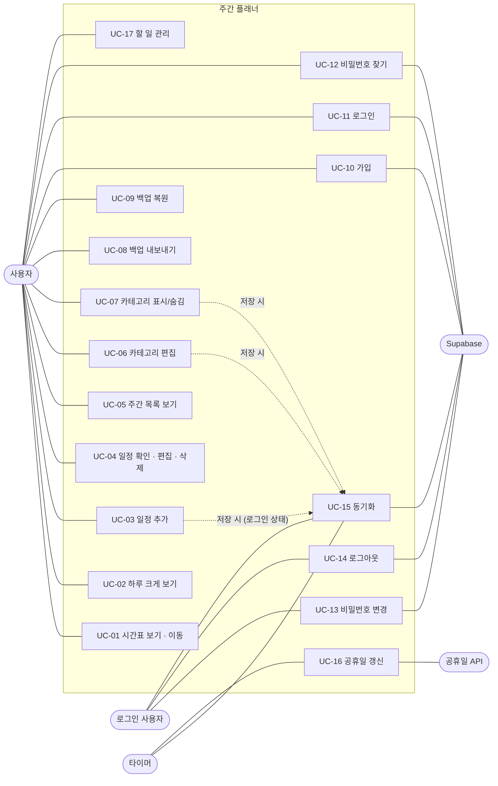
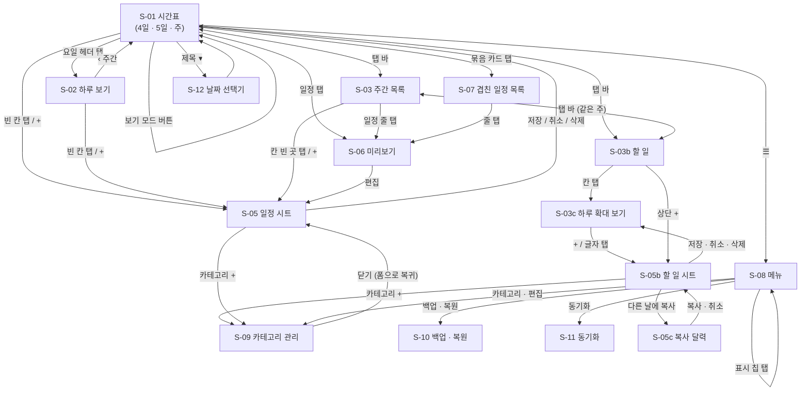
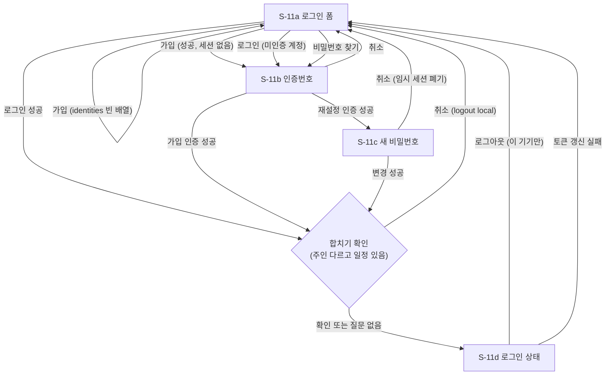
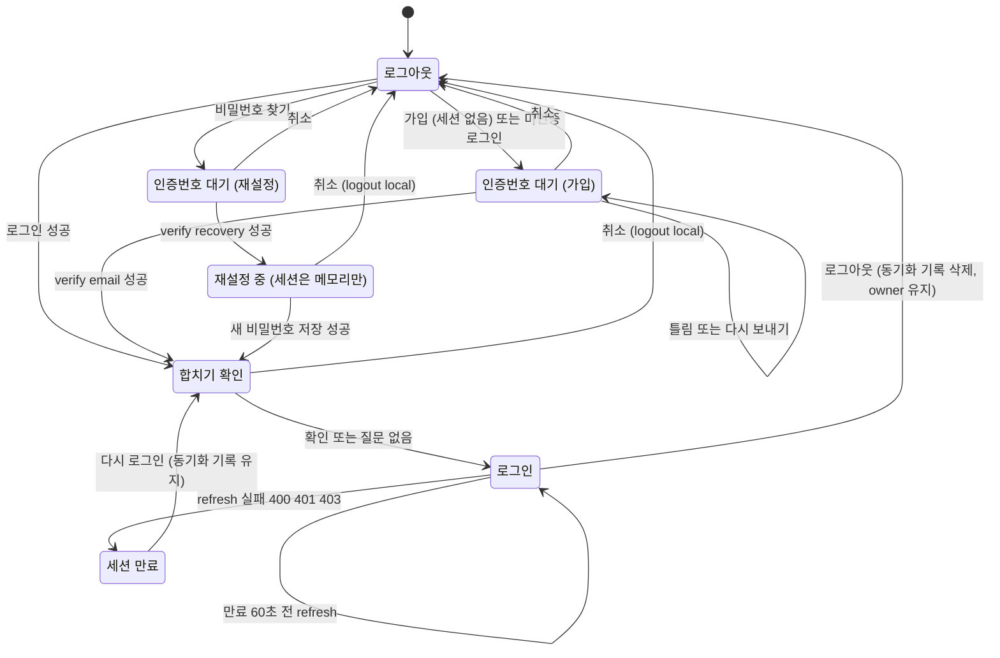
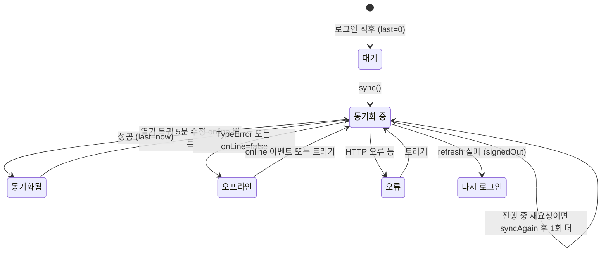

# 02. 유스케이스 · 화면 흐름

## 1. 액터

| 액터 | 설명 |
|---|---|
| 사용자 | 앱을 쓰는 본인. 로그인 여부와 무관하게 모든 로컬 기능 사용 |
| 로그인 사용자 | 동기화 계정에 로그인한 사용자 |
| Supabase | 인증(메일 발송 포함) · 데이터 저장 서버 |
| 공휴일 API | Nager.Date |
| 시스템 타이머 | 1분마다 화면 갱신, 5분마다 동기화 |

## 2. 유스케이스 목록

| ID | 유스케이스 | 액터 | 관련 요구사항 |
|---|---|---|---|
| UC-01 | 시간표 보기 · 이동 (모드 전환, 스와이프, PC 버튼 · 키 · 트랙패드, 오늘, 날짜 점프) | 사용자 | FR-01 ~ FR-09a |
| UC-02 | 하루 크게 보기 | 사용자 | FR-04 |
| UC-03 | 일정 추가 | 사용자 | FR-10, FR-11, FR-13, FR-14 |
| UC-04 | 일정 확인 · 편집 · 삭제 | 사용자 | FR-12, FR-15, FR-16 |
| UC-05 | 주간 목록 보기 | 사용자 | FR-30 ~ FR-32 |
| UC-06 | 카테고리 편집 | 사용자 | FR-20 ~ FR-22 |
| UC-07 | 카테고리 표시 / 숨김 | 사용자 | FR-23 |
| UC-08 | 백업 내보내기 | 사용자 | FR-51, FR-54 |
| UC-09 | 백업 복원 | 사용자 | FR-52, FR-53 |
| UC-10 | 가입 (인증번호) | 사용자, Supabase | FR-61, FR-62, FR-71 |
| UC-11 | 로그인 | 사용자, Supabase | FR-63, FR-70 |
| UC-12 | 비밀번호 찾기 (인증번호) | 사용자, Supabase | FR-64, FR-71 |
| UC-13 | 비밀번호 변경 | 로그인 사용자, Supabase | FR-65 |
| UC-14 | 로그아웃 | 로그인 사용자, Supabase | FR-66 |
| UC-15 | 동기화 (자동 · 수동) | 로그인 사용자, Supabase, 타이머 | FR-67 ~ FR-69 |
| UC-16 | 공휴일 갱신 | 공휴일 API, 타이머 | FR-40, FR-41 |
| UC-17 | 할 일 관리 (요일별 · 확대 보기 · 체크 · 달력 표시 · 순서 바꾸기 · 날짜 바꾸기 · 복사) | 사용자 | FR-33 ~ FR-39e |

## 3. 주요 시나리오

### UC-03 일정 추가

| 항목 | 내용 |
|---|---|
| 사전 조건 | 시간표 또는 주간 목록 화면 |
| 기본 흐름 | 1) 빈 칸 탭(그 시각, 30분 단위) 또는 `+` (09:00) → 2) 시트 열림, 제목 칸에 자동 포커스 → 3) 제목 입력 → 4) `매주 반복`이면 요일(탭한 날의 요일이 기본 선택), `특정 날짜`면 날짜 → 5) 시간 `09:00 → 10:00` → 6) 카테고리 칩 선택(마지막으로 쓴 것 유지) → 7) 필요 시 `장소 · 기간 · 색` 펼침 → 8) `저장` |
| 대안 흐름 | 3a) 제목 없음 → "제목을 입력해 주세요" · 5a) 종료 ≤ 시작 → 종료 칸 빨강, 저장 막힘 · 5b) 시작을 바꾸면 길이 유지한 채 종료 이동 · 4a) 요일 0개 → "요일을 하나 이상 골라 주세요" · 7a) 반복 종료일 < 시작일 → "반복 종료일이 시작일보다 빨라요" · 6a) 카테고리 칩 `+` → 카테고리 관리로 갔다가 돌아옴 |
| 사후 조건 | `localStorage` 저장 + 자동 백업 갱신. 로그인 상태면 변경 표시 후 1.2초 뒤 업로드 |

### UC-05 주간 목록 보기

| 항목 | 내용 |
|---|---|
| 기본 흐름 | 1) 아래 탭 바의 오른쪽(4칸 아이콘) → 2) 지금 보던 날이 든 주가 2×4 그리드로 → 3) 왼쪽 위 미니 달력 날짜 탭 → 그 주로 이동 → 4) 일정 줄 탭 → 미리보기 카드 → 5) 칸의 빈 곳 탭 → 그 날짜로 일정 추가 |
| 대안 흐름 | 좌우 스와이프 → 한 주씩 · `‹ ›` → 달력만 다른 달로 · `오늘` → 이번 주 |
| 사후 조건 | 화면 형식(`list`)을 기억, 다음 실행 시 그대로. 시간표로 돌아가면 고른 주(오늘이 그 주면 오늘부터)로 맞춤 |

### UC-06 카테고리 편집

| 항목 | 내용 |
|---|---|
| 기본 흐름 | 1) ☰ → 카테고리 `편집` → 2) 줄(또는 ✏️) 탭 → 바로 아래 수정 칸 → 3) 이름·색·이모지 변경 → `저장` |
| 대안 흐름 | 3a) 이름 비움 → 저장 안 됨(이름 칸 포커스) · 3b) `취소` → 그대로 · 4) ✕ → "이 카테고리를 삭제할까요?" 확인 → 삭제(마지막 1개는 삭제 불가) · 5) 아래 `새 카테고리`에서 이름·색·이모지 → `+ 카테고리 추가` |
| 사후 조건 | 색을 바꾸면 그 카테고리 색을 쓰던 일정도 새 색. 메뉴 필터·시간표 즉시 반영 |

### UC-08 / UC-09 백업 · 복원

| 항목 | 내용 |
|---|---|
| 내보내기 | ☰ → `백업 · 복원` → `백업 파일 내보내기` → (iOS) 공유 시트 / (PC) `플래너-백업-YYYY-MM-DD.json` 다운로드 → 마지막 내보내기 시각 기록 |
| 복원 | `백업 파일에서 복원` → 파일 선택 → JSON 파싱 → 항목별 정제(`sanitizeEvent`/`sanitizeCats`) → "현재 일정을 이 백업으로 덮어쓸까요? (불러올 일정: N개, 카테고리: M개)" → 확인 시 덮어쓰기 |
| 예외 | 파싱 실패 → "⚠️ 파일을 읽을 수 없어요 (형식 확인)" · v1 백업(일정 배열만) → 모르는 태그는 "복원된 태그" 생성 · 형식이 이상한 항목은 개수에서 빠짐 |

### UC-10 가입 (인증번호)

| 단계 | 사용자 | 앱 | 서버 |
|---|---|---|---|
| 1 | ☰ → 데이터 → `동기화` | 로그인 폼 표시 | |
| 2 | 이메일 · 비밀번호(6자 이상) → `가입` | 6자 미만이면 즉시 "비밀번호는 6자 이상" | |
| 3 | | `POST /auth/v1/signup` | 계정 생성(미인증), 메일로 6자리 발송 |
| 4 | | 응답에 세션 없음 → `identities`가 빈 배열이면 "이미 가입된 이메일 · 로그인을 눌러 주세요" / 아니면 인증번호 화면 + 5분 타이머 | |
| 5 | 6자리 입력(또는 iOS 자동 채우기) | 6자리가 되면 자동으로 `POST /auth/v1/verify (type=email)` | 세션 발급 |
| 6 | | `startSession()` → (기기 일정이 있고 주인이 다르면) 합치기 확인 → 동기화 | |
| 예외 | 틀린 번호 | 칸 빨강 + "인증번호가 틀렸거나 만료됐어요", 칸 비움 | |
| 예외 | 5분 경과 | "시간 초과 · 다시 보내기를 눌러 주세요" | |
| 예외 | `다시 보내기` | `POST /auth/v1/resend (type=signup)` → "다시 보냈어요", 타이머 재시작 | |

### UC-11 로그인

| 단계 | 내용 |
|---|---|
| 1 | 이메일 · 비밀번호 → `로그인` (비밀번호 칸에서 Enter도 가능) |
| 2 | `POST /auth/v1/token?grant_type=password` |
| 3 | 성공 → 비밀번호 칸 비움 → `startSession()` |
| 4 | 이 기기에 일정이 있고 `weekly-planner-owner`가 이 계정이 아니면 "이 기기 일정 N개를 OO 계정에 합칠까요? 취소하면 로그인하지 않아요." |
| 5a | 확인 → owner 기록 → 세션 저장 → 동기화(받기 → 변경 표시 → 올리기) |
| 5b | 취소 → 받은 토큰으로 `logout?scope=local` → "로그인 취소됨", 아무것도 업로드 안 함 |
| 예외 | 틀림 → "이메일 또는 비밀번호가 틀려요" (계정 유무 구분 없음) · 미인증 계정 → 인증번호 화면 ("메일 인증이 아직이에요 · 다시 보내기를 눌러 주세요") |

### UC-12 비밀번호 찾기

| 단계 | 내용 |
|---|---|
| 1 | 로그인 폼에 이메일 입력 → `비밀번호 찾기` |
| 2 | `POST /auth/v1/recover` → **계정 유무와 관계없이** 인증번호 화면으로 |
| 3 | 6자리 → `POST /auth/v1/verify (type=recovery)` → 세션을 **메모리(`recov`)에만** 보관 |
| 4 | `새 비밀번호 정하기` 화면 → 새 비밀번호 2회 → `변경` → `PUT /auth/v1/user` |
| 5 | 성공 → 그 세션으로 `startSession()` (합치기 확인 포함) → 로그인 상태 + "비밀번호 변경됨" |
| 예외 | `취소` 또는 시트 닫기 → 임시 세션 `logout?scope=local`, `recov` 폐기 |

### UC-15 동기화

| 트리거 | 동작 |
|---|---|
| 앱 실행 (로그인 상태) | `sync()` |
| 화면 복귀 (`visibilitychange`) | `sync()` |
| 온라인 복귀 (`online`) | `sync()` |
| 5분마다 (화면이 보일 때) | `sync()` |
| 로컬 변경 (일정·카테고리·숨김) | 변경 표시 → 1.2초 디바운스 → `sync()` |
| `지금 동기화` 버튼 | `sync()` |

자세한 알고리즘은 [03-시스템설계.md §3](03-시스템설계.md#3-동기화-설계) 참고.

### UC-17 할 일 순서 바꾸기 · 날짜 바꾸기 · 복사 (v48)

| 항목 | 내용 |
|---|---|
| 사전 조건 | 할 일 화면(칸) 또는 하루 확대 보기, 같은 날 할 일 2개 이상(순서 바꾸기) |
| 기본 흐름 — 순서 | 1) 할 일을 0.38초 누름 → 2) 살짝 커지며 떠오르고 나머지는 비킬 준비 → 3) 위아래로 끌면 지나간 항목이 한 칸씩 비킴 → 4) 놓으면 그 자리로, 그 날 전체 순서를 0부터 다시 매겨 저장 |
| 기본 흐름 — 날짜 | 1) 글자 탭 → 편집 시트 → 2) `오늘` · `내일` · `1주 뒤` 탭 → 3) `저장` → 그 날 맨 아래로 이동 |
| 기본 흐름 — 복사 | 1) 편집 시트 `다른 날에 복사` → 2) 복사 달력에서 여러 날 탭(원래 날짜는 테두리) → 3) `복사 n` → 4) 편집 시트로 돌아와 `n일에 복사됨` |
| 대안 흐름 | 1a) 누르자마자 움직임 → 끌기 대신 스크롤 · 주 넘기기 · 2a) 놓은 직후 0.45초 안의 탭은 무시(실수 체크 방지) · 복사 2a) 아무 날도 안 고름 → `복사` 비활성 · 복사 2b) `취소` → 편집 시트로 |
| 사후 조건 | `ord`(순서) · `date` 변경 또는 새 할 일 저장, 로그인 상태면 동기화 |

## 4. 화면 목록

| ID | 화면 / 요소 | DOM | 진입 | 주요 요소 |
|---|---|---|---|---|
| S-01 | 시간표 (N일 / 주) | `.planner` (`#hdays`, `#days`) | 기본 | 제목▾, 보기 모드, `‹ 오늘 ›`(`‹ ›`는 PC만), +, ☰, 요일 헤더, 시간 눈금, 일정 카드, 현재시각선 |
| S-02 | 하루 크게 보기 | `.planner` (`view="day"`) | 요일 헤더 탭 | `‹ 주간`, 장소·시간 포함 카드 |
| S-03 | 주간 목록 | `#agenda` | 탭 바 오른쪽 | 미니 달력, 요일 7칸, 일정 줄(색 띠 + 시작 시각) |
| S-04 | 탭 바 | `#tabbar` | 항상 | 시간표 / 주간 목록 / 할 일 |
| S-03b | 할 일 (요일별) | `#todos` | 탭 바 세 번째 | 회색 바탕 + 흰 카드 2×4, 미니 달력(점 · 달력 표시 네모), 칸마다 6개 + `… +n`, 원형 체크, 머리글 `할 일 / 11월 2일 – 8일 · 남은 n` |
| S-03c | 하루 확대 보기 | `#todoDaySheet` | 할 일 칸 탭 | `‹ 날짜 ›`, `+`, 큰 목록(체크 · 글자 탭 = 편집), 닫기 |
| S-05b | 할 일 추가 · 편집 시트 | `#todoSheet` | 확대 보기 `+`, 글자 탭, 상단 `+` | 취소/제목/저장, 큰 제목, 최근 제목 칩(추가 때), 날짜 + `오늘 · 내일 · 1주 뒤`, 할 일 카테고리 칩 + `+`, `다른 날에 복사`(편집 때만), 삭제 |
| S-05c | 복사 달력 (v48) | `#todoPickSheet` | 할 일 시트 `다른 날에 복사` | 취소 / 제목 / `복사 n`, 달력(`‹ ›` 달 이동, 원래 날짜 테두리, 고른 날 검정) |
| S-05 | 일정 추가 · 편집 시트 | `#sheet` | 빈 칸·+·편집 | 취소/제목/저장, 큰 제목, 최근 제목 칩(추가 때), 반복/특정 날짜, 요일+시간 묶음, 카테고리 칩, `장소 · 기간 · 색`, `일정 삭제` |
| S-06 | 미리보기 카드 | `#peek` | 일정 탭 | 카테고리(이모지), 제목, 시간, 반복/날짜, 장소, `편집` |
| S-07 | 겹친 일정 목록 | `#listSheet` | 묶음 카드 탭 | 일정 줄 → 미리보기 |
| S-08 | 메뉴 | `#menuSheet` | ☰ | **카테고리**: 표시 칩(`n / 전체`), 편집 · **데이터**: 동기화(상태), 백업 · 복원(`3일 전`) |
| S-09 | 카테고리 관리 | `#catSheet` | 메뉴 `편집`, 일정 시트 `+`, 할 일 시트 `+` | `일정 | 할 일` 전환, 목록(줄 탭 → 인라인 수정, 할 일 쪽은 `달력 표시` 스위치 · `달력` 배지), 새 카테고리, 마지막 하나는 ✕ 비활성 |
| S-10 | 백업 · 복원 | `#backupSheet` | 메뉴 | 내보내기, 마지막 시각, 복원 |
| S-11a | 동기화 — 로그인 폼 | `#acctForm` | 메뉴 `동기화` (비로그인) | 이메일, 비밀번호, 로그인, 가입, 비밀번호 찾기 |
| S-11b | 동기화 — 인증번호 | `#acctCodeBox` | 가입 / 비밀번호 찾기 / 미인증 로그인 | 이메일, 남은 시간, 6칸, 확인, 취소, 다시 보내기 |
| S-11c | 동기화 — 새 비밀번호 | `#acctRec` | 재설정 인증 성공 | 새 비밀번호 ×2, 변경, 취소 |
| S-11d | 동기화 — 로그인 상태 | `#acctIn` | 메뉴 `동기화` (로그인) | 계정·상태, 지금 동기화, 비밀번호 변경(펼침 `#acctPwBox`), 로그아웃 |
| S-12 | 날짜 선택기 | `#jumpDate` (OS 기본) | 제목 탭 | |
| S-13 | 확인 대화상자 | `#dlg` (앱 안, v53) · `confirm()` (OS 기본) | 쓰던 내용 나가기 / 복원, 합치기, 로그아웃 | `저장하지 않고 나갈까요?` [계속 쓰기] [나가기] |
| S-15 | 큰 달력 (v54) | `#calSheet` | 미니 달력 제목 `▾` (주간 목록 · 할 일) | `‹ 년 월 ›`, 48×46 칸 달력, 닫기 |
| S-14 | 스낵바 (v53) | `#snack` | 일정 · 할 일 · 카테고리 삭제 | 결과 문구 + `되돌리기`, 4초 |

## 5. 화면 흐름도

### 동기화 시트 내부 흐름

## 6. 상태도

### 6.1 인증 상태

| 상태 | 저장되는 것 | 메뉴 표시 |
|---|---|---|
| 로그아웃 | `weekly-planner-owner`(있으면) | `로그인` |
| 인증번호 대기 | 메모리 `codeFor` (이메일·종류) | `로그인` |
| 재설정 중 | 메모리 `recov` (토큰·세션) — **저장 안 함** | `로그인` |
| 로그인 | `weekly-planner-auth`, `weekly-planner-sync` | 동기화 상태 |
| 세션 만료 | `weekly-planner-sync` 유지 (`err="relogin"`) | `다시 로그인` (빨강) |

### 6.2 동기화 상태 (로그인 상태에서)

| 상태 | 메뉴 오른쪽 | 동기화 시트 상세 |
|---|---|---|
| 대기 | `대기` | `대기` |
| 동기화 중 | `동기화 중` | `동기화 중…` (버튼 비활성) |
| 동기화됨 | `방금` / `N분 전` / `N시간 전` / `N일 전` | `동기화됨 · 3분 전` |
| 오프라인 | `오프라인` | `오프라인 · 올릴 것 N개` |
| 오류 | `오류` (빨강) | `오류 · (메시지 80자)` (빨강) |
| 다시 로그인 | `다시 로그인` (빨강) | 로그인 폼 |
