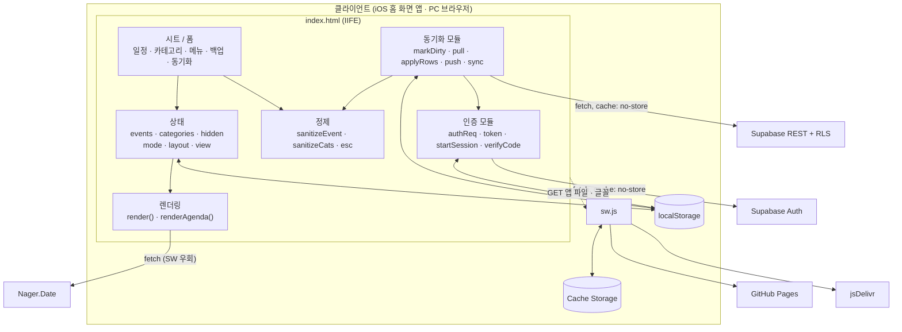
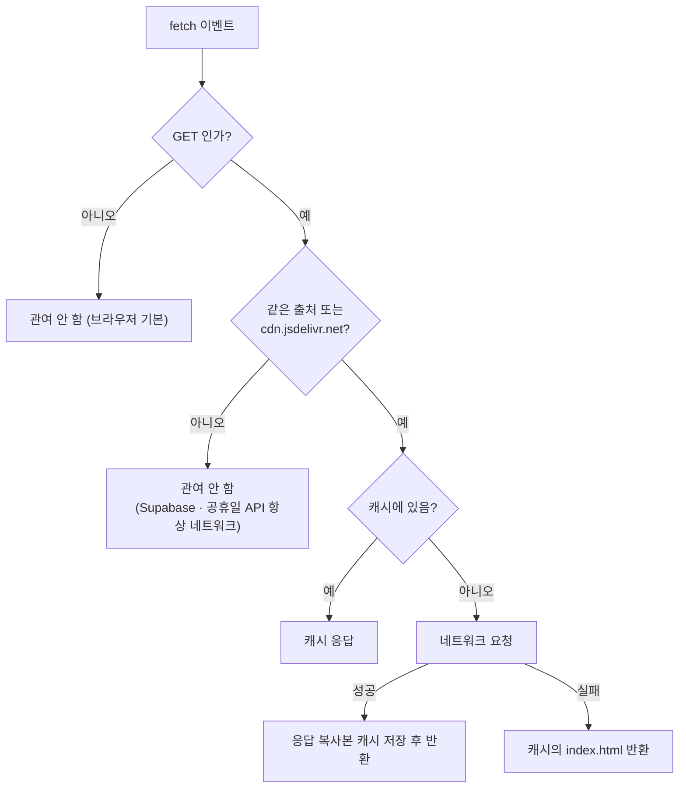
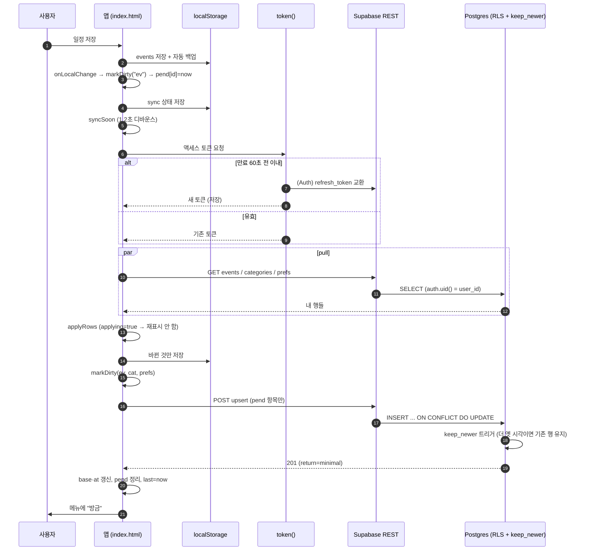
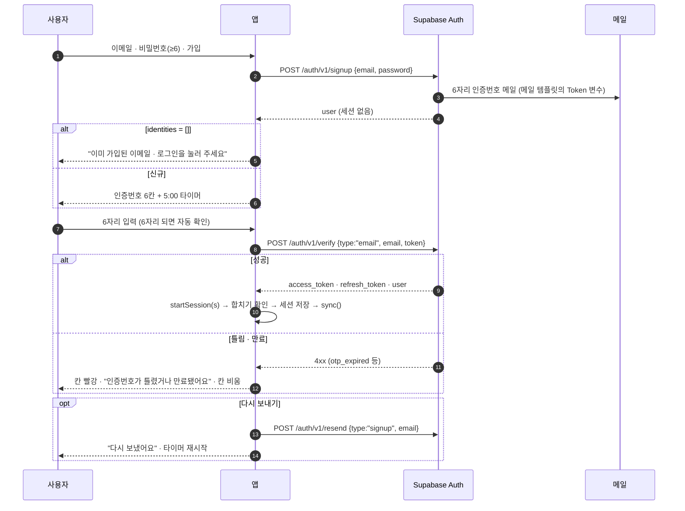
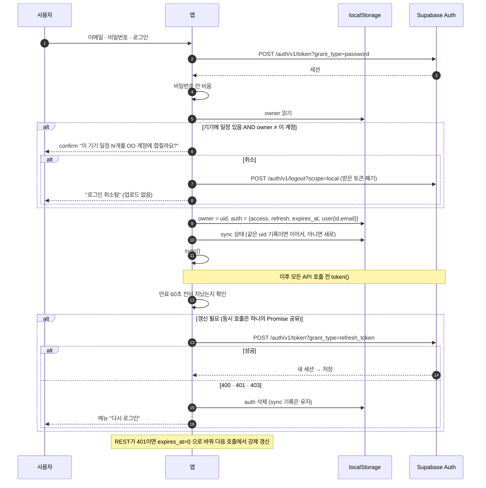
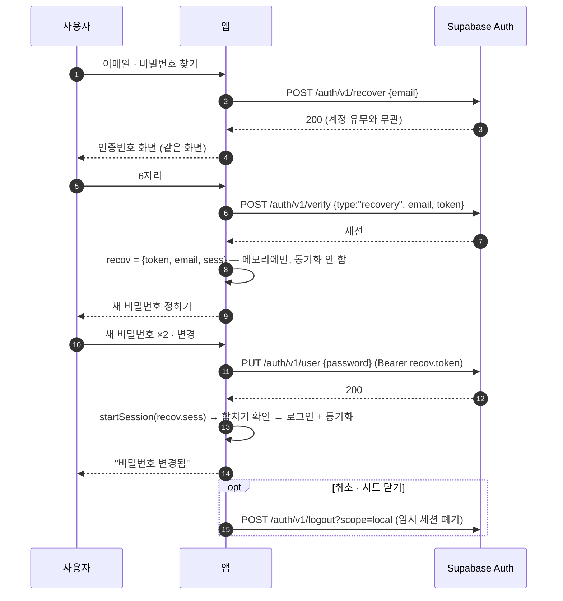
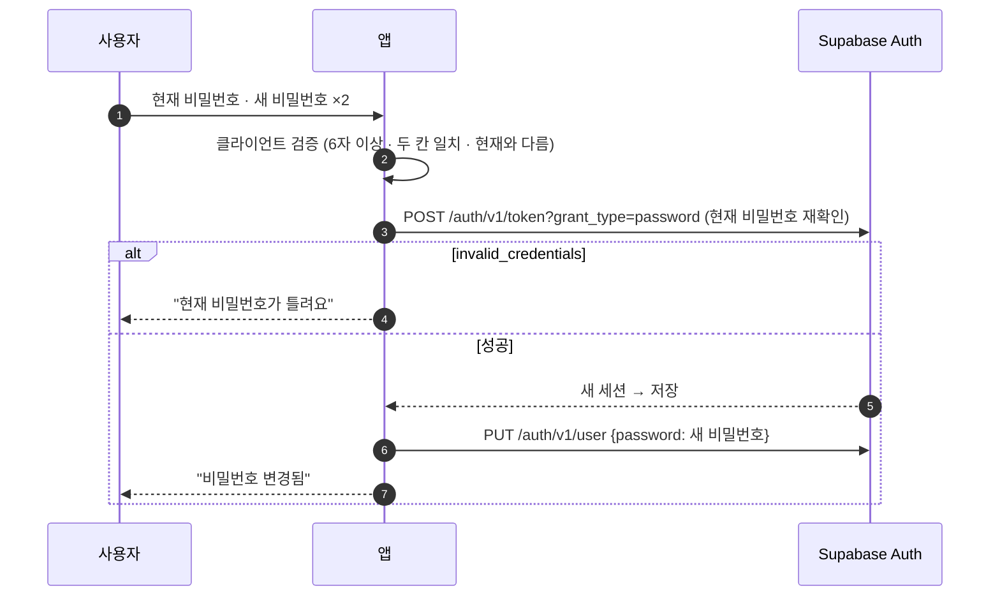
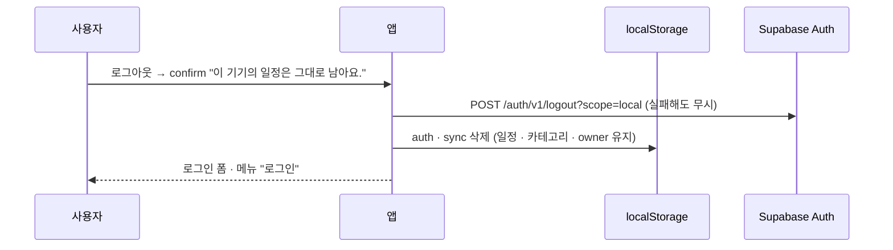
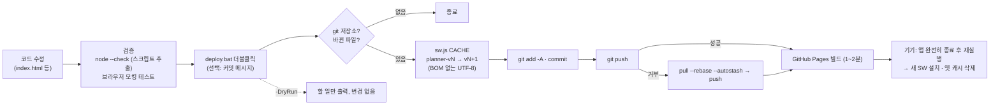

# 03. 시스템 설계

## 1. 아키텍처

### 1.1 구성 요소

| 구성 요소 | 위치 | 역할 |
|---|---|---|
| 앱 셸 | `index.html` | HTML 마크업 + `<style>` + `<script>` (하나의 IIFE, `"use strict"`) |
| 서비스워커 | `sw.js` | 앱 파일·글꼴 캐시, 오프라인 실행 |
| 매니페스트 | `manifest.webmanifest` | 이름 `주간 플래너`/`플래너`, `standalone`, 세로 고정, 아이콘 192/512(maskable) |
| 로컬 저장소 | `localStorage` | 일정·카테고리·설정·동기화 상태 ([04-DB설계 §6](04-DB설계.md#6-클라이언트-localstorage-키-목록)) |
| 호스팅 | GitHub Pages (`main` 브랜치 루트) | 정적 파일 제공, HTTPS |
| 인증 | Supabase Auth (`/auth/v1`) | 가입·로그인·OTP 확인·토큰 갱신·비밀번호 변경·로그아웃 |
| 데이터 API | Supabase PostgREST (`/rest/v1`) | `events` · `categories` · `prefs` · `todos` · `todo_categories` 조회·upsert, RLS로 본인 행만 |
| DB | Supabase Postgres | 테이블 3개 + RLS + `keep_newer` 트리거 ([04-DB설계](04-DB설계.md)) |
| 공휴일 | Nager.Date (`date.nager.at`) | 연도별 한국 공휴일 |
| 글꼴 | jsDelivr (Pretendard Variable) | dynamic subset CSS |

### 1.2 배치도



### 1.3 `index.html` 내부 구조 (위에서 아래 순서)

| 구역 | 주요 식별자 | 비고 |
|---|---|---|
| 상수 · 상태 | `KEY`, `CAT_KEY`, `DEFAULT_CATS`, `COLORS`, `DOW`, `mode`, `layout`, `view`, `winStart`, `anchor` | |
| 마이그레이션 | `migrateCats`, `migrateTone`(`COLOR_REMAP`), `migrateEmoji` | 예전 데이터 자동 보정 (한 번) |
| 저장 헬퍼 | `load`, `save`(+ 자동 백업), `saveCategories`, `saveHidden` | 저장 후 `onLocalChange(kind)` 호출 |
| 공휴일 | `loadHolidayCache`, `refreshHolidays` | 14일 신선도 |
| 렌더링 | `render`, `renderAgenda`, `clusterize`, `evNode`, `clusterNode` | 문자열 조립 → `innerHTML`, 사용자 문자열은 `esc()` |
| 탐색 | `goPrev`, `goNext`, `setLayout`, 스와이프, PC `‹ ›` · ← → · `wheel` 거리 누적, 키보드(`KEY_LAYERS`: Esc · Enter · N · T · 1~3), `jumpDate`, `weekStartOf`(일요일 시작) | 요일 데이터 번호(`DOW` · `wd`: 월=0)와 화면 순서(`CAL_DOW`: 일~토)를 분리 (v49) |
| 할 일 | `renderTodos`, `renderTodoDay`, `toggleTodo` → `settleTodos`, `chkFromEvent`, `tdLift`/`tdMove`/`tdDrop`, `renderPick` | 정렬 `todoOrder`: 완료는 아래, 그다음 `ord`(없으면 만든 시각 `at`) |
| 시트 | `openPeek`, `openAdd`, `openEdit`, `openCatManage`, `openMenu`, `openBackup`, `openAccount` | 공통 `openSheet`/`closeSheet` + `.scrim` |
| 백업 | `sanitizeCats`, `sanitizeEvent`, `exportBtn`, `importFile` | v2 형식 |
| 동기화 | `newSync`, `markDirty`, `pull`, `applyRows`, `push`, `sync`, `syncWord`, `syncStatusUI` | |
| 인증 | `authReq`, `setSession`, `token`, `api`, `authMsg`, `startSession`, `doAuth`, `codeMode`, `verifyCode`, `changePw`, `saveRecovery` | |
| 초기화 | `render()`, `setInterval(render, 60000)`, `if(auth) sync()`, 메일 링크 해시 처리 | |
| SW 등록 | 별도 `<script>` | `load` 이후 `sw.js` 등록 |

## 2. 서비스워커 캐시 전략

| 단계 | 동작 |
|---|---|
| install | `planner-vN` 캐시에 앱 셸 7개 파일 미리 저장(`./`, `index.html`, 매니페스트, 아이콘 4개), `skipWaiting()` |
| activate | 이름이 다른(이전 버전) 캐시 전부 삭제, `clients.claim()` |
| fetch | `GET`만 처리. **같은 출처 또는 `cdn.jsdelivr.net`만** 캐시 대상, 그 밖(Supabase, 공휴일 API)은 서비스워커가 관여하지 않음 |
| 캐시 정책 | Cache First → 없으면 네트워크 → 받은 응답을 캐시에 저장 → 네트워크 실패 시 `index.html` 반환 |
| 갱신 | 배포 때마다 `deploy.ps1`이 `CACHE` 버전을 +1 → 새 SW 설치 → 옛 캐시 삭제 → 앱을 다시 열면 새 버전 |



**변경 이력 (버그 수정)**: v39 이전에는 출처 필터가 없어 Supabase · 공휴일 API 응답까지 캐시에 영구 저장될 수 있었음 → 동기화가 옛 응답을 받거나 공휴일 14일 갱신이 무력화되는 문제. v39에서 출처 필터를 추가하고, 인증·REST 요청에는 `cache: "no-store"`도 지정.

## 3. 동기화 설계

### 3.1 설계 원칙

| 원칙 | 구현 |
|---|---|
| 로컬 우선 | 모든 쓰기는 `localStorage`에 먼저. 서버는 실패해도 앱 동작에 영향 없음 |
| 항목 단위 | 일정 1개 · 카테고리 1개 = 서버 1행. 숨김 설정은 사용자당 1행(`prefs`) |
| 항목별 LWW | 행마다 `updated_at`(기기 시각 ms). 더 큰 쪽이 이김 — 클라이언트(`applyRows`)와 서버(`keep_newer` 트리거) 양쪽에서 |
| 삭제 전파 | 행을 지우지 않고 `deleted=true` + `data={}`로 upsert (tombstone) |
| 변경분만 전송 | `pend`에 표시된 항목만 업로드 |
| 받은 데이터 불신 | 서버 행도 `sanitizeEvent`/`sanitizeCats`/`ID_RE`로 정제 후 반영 |

### 3.2 동기화 상태 (`weekly-planner-sync`)

```text
{
  base: { ev:{id: JSON}, cat:{id: JSON}, prefs: JSON|null },  // 서버와 마지막으로 맞춘 내용
  at:   { ev:{id: ms},   cat:{id: ms},   prefs: ms },         // 그때의 서버 updated_at
  pend: { ev:{id: ms},   cat:{id: ms},   prefs: ms },         // 아직 안 올린 변경 (고친 시각)
  mark: { ev:{id: JSON|"\u0000del"}, cat:{...}, prefs?: JSON }, // pend를 찍을 때의 내용
  last: ms,       // 마지막 성공 시각
  err:  ""|"offline"|"relogin"|"<메시지>",
  uid:  "<계정 uid>" // 이 기록이 어느 계정 것인지
}
```

| 필드 | 쓰는 곳 | 의미 |
|---|---|---|
| `base` | `markDirty` 비교 기준, `applyRows`/`push` 성공 시 갱신 | "서버가 알고 있는 내용" |
| `at` | `applyRows`의 중복 수신 판정 | 이미 받은(또는 올린) 버전의 시각 |
| `pend` | `applyRows`의 충돌 판정, `push` 대상 | 로컬 변경 시각 |
| `mark` | `markDirty`의 재표시 방지 | 같은 내용으로 `pend` 시각이 계속 갱신되지 않게 |

### 3.3 알고리즘

**markDirty(kind)** — 로컬 변경 감지

```text
cur = 현재 로컬 항목들 (id → 객체)
for id in cur:
    ref = mark[id] 있으면 mark[id], 없으면 base[id]
    if JSON(cur[id]) != ref:  pend[id] = now;  mark[id] = JSON(cur[id])
for id in (base ∪ mark):
    if id not in cur and mark[id] != DEL:  pend[id] = now;  mark[id] = DEL   # 삭제 → tombstone 예정
```

**applyRows(kind, rows)** — 받은 행 반영

```text
for rw in rows:
    if not ID_RE(rw.id): skip
    ts = rw.updated_at
    if pend[id] and pend[id] >= ts: skip        # 내 기기 쪽이 더 최근 → 내 것 유지 (나중에 push)
    if ts <= at[id]: skip                        # 이미 받은 버전
    obj = rw.deleted ? null : sanitize(rw.data)  # 정제 실패 또는 id 불일치 → null 취급
    obj == null → 로컬에서 삭제, base 삭제
    else        → 로컬 반영, base = JSON(obj)
    at[id] = ts;  pend·mark 삭제
※ 카테고리가 전부 사라지는 결과면 반영하지 않음 (최소 1개 보장)
```

**push()** — 변경분 업로드

```text
rows = [ {user_id, id, data: cur[id] or {}, deleted: !cur[id], updated_at: pend[id]} for id in pend ]
POST /rest/v1/{events|categories|todos|todo_categories}?on_conflict=user_id,id   (Prefer: resolution=merge-duplicates)
※ v46: 받기는 종류마다 getAll() — id 오름차순 1000행씩, 마지막 id 다음부터(키셋 방식, offset 아님 → 받는 도중 다른 기기가 행을 추가해도 건너뛰지 않음). 1000행 미만이 오면 끝, 안전장치 200쪽. 한 쪽이라도 실패하면 pull 전체 실패 → 아무것도 반영 안 함
※ v45: 동기화 종류 ev · cat · todo · tcat · prefs. 나중에 생긴 표(todos · todo_categories)는 받기에서 404(PGRST205)면 tableMissing[종류]=true → 그 종류만 올리지 않고 pend에 모아 둠, 다음 동기화 때 다시 확인
성공 시: base·at 갱신, pend[id]가 그대로면(업로드 중 새 수정 없음) pend·mark 삭제
prefs: pend.prefs 있으면 prefs 1행 upsert (on_conflict=user_id)
```

**sync()** — 순서가 핵심

```text
if 진행 중: syncAgain = true; return
pull()  →  markDirty(ev, cat, prefs)  →  push()  →  last = now
실패: refresh 실패 → err="relogin" / TypeError·offline → "offline" / 그 외 → 메시지
끝나면 syncAgain이면 한 번 더
단계마다 로그인 여부 재확인: 받는 사이 로그아웃했으면 받은 내용 버림, 올리기 · 상태 저장 · 오류 표시 안 함 (v44)
진행 중에 다시 불리면: sync(true)(수정 직후 예약)만 syncAgain 표시 → 끝난 뒤 한 번 더. 화면 복귀 · 5분 타이머 · 온라인 복귀 · 지금 동기화는 진행 중인 동기화에 합침 (v46)
```

### 3.4 시퀀스 — 일반 동기화



### 3.5 충돌 · 삭제 처리 규칙

| 상황 | 결과 | 근거 |
|---|---|---|
| A 기기 10:00 수정, B 기기 10:05 수정 | B 내용이 남음 | 서버 `keep_newer`가 10:00 업데이트를 무시, A는 다음 pull에서 B 내용 수신 |
| 로컬 미업로드 변경(10:05)이 있는데 서버에 10:00 행 | 로컬 유지 → 다음 push | `applyRows`: `pend >= ts` 이면 skip |
| 서버 행이 이미 받은 버전 | 무시 | `ts <= at[id]` |
| 한 기기에서 삭제 | `deleted=true, data={}` upsert → 다른 기기 pull 시 로컬 삭제 | tombstone |
| 삭제(10:00) vs 다른 기기 수정(10:05) | 수정이 이김 (되살아남) | 같은 LWW 규칙 |
| 업로드 도중 같은 항목을 또 수정 | 두 번째 수정은 `pend`에 남아 다음 sync에서 업로드 | `pend[id]===rw.updated_at`일 때만 정리 |
| 서버 행의 `data`가 형식 위반 · id 불일치 | 그 항목은 삭제로 취급(반영 안 함) | 정제 실패 → `null` |
| 처음 로그인한 기기, 같은 id가 양쪽에 | **서버 것이 이김** | pull을 markDirty보다 먼저 (아래 버그 참고) |

> **테스트 중 발견한 버그 (수정 완료)**: 초기 구현은 `markDirty → pull → push` 순서였다. 처음 로그인하면 `base`가 비어 있어 로컬 기본 카테고리(예: 기본 "강의")가 **방금 수정된 것**으로 표시되고, `pend` 시각이 서버의 (다른 기기에서 이름을 바꾼) 카테고리보다 최신이라 **서버의 편집 내용을 덮어썼다**. `pull → markDirty → push`로 순서를 바꿔, 처음에는 서버 행이 먼저 `base`로 들어오고 로컬에만 있는 항목만 업로드되게 했다. 평소 수정은 저장 시점(`onLocalChange`)에 이미 표시되므로 순서 변경의 부작용 없음.

### 3.6 알려진 한계

| 한계 | 영향 | 대응 |
|---|---|---|
| `updated_at`이 기기 시계 기준 | 시계가 크게 틀린 기기의 수정이 부당하게 이기거나 질 수 있음 | 개인 1인 사용 · 기기 시계 자동 동기화 전제로 수용 |
| tombstone 영구 보관 | 삭제 행이 계속 쌓임 | 개인 규모에서 무시 가능, 정리 작업은 백로그 |
| 전체 pull | 매번 내 행 전부 조회 (`updated_at` 필터 없음) | 개인 규모(수백 행)에서 단순함 우선 |
| 일정 단위 LWW | 같은 일정의 서로 다른 필드를 두 기기에서 고치면 한쪽 변경 유실 | 필드 단위 병합은 과설계로 판단 |

## 4. 인증 흐름

공통: 모든 인증 요청은 `authReq(path, body, token, method)` — `apikey` 헤더(공개용 키) + 선택적 `Authorization: Bearer`, `cache: "no-store"`. 오류는 `{status, code, message}`로 변환 후 `authMsg()`가 한국어로 매핑([05-API명세 §4](05-API명세.md#4-오류--한국어-메시지-매핑)).

### 4.1 가입 (6자리 인증번호)



### 4.2 로그인 · 합치기 확인 · 토큰 갱신



### 4.3 비밀번호 찾기 (인증번호)



### 4.4 비밀번호 변경 (로그인 상태)



### 4.5 로그아웃 (이 기기만)



### 4.6 메일 링크 해시 처리 (호환용, 로그인 안 함)

v43부터 메일은 인증번호를 보내지만, 예전 링크(`#access_token=...&type=...`)로 열린 경우를 위해 처리 코드를 남겼다. **링크의 토큰은 남이 만든 것일 수 있으므로 로그인·동기화에 쓰지 않는다** ([07-보안설계 §4.2](07-보안설계.md#42-2차-점검--로그인-csrf--계정-섞임)).

| 해시 | 처리 |
|---|---|
| 공통 | 즉시 `history.replaceState`로 주소에서 토큰 제거 |
| `error=` 만 있음 | "링크가 만료됐어요 · 다시 요청해 주세요" 또는 "링크 오류 · 다시 요청해 주세요" |
| `type=recovery` | `GET /auth/v1/user`로 이메일만 확인 → `recov`(메모리)로 새 비밀번호 화면 → 변경 후 임시 세션 폐기 → **새 비밀번호로 직접 로그인** |
| 그 외 (`signup` 등) | `logout?scope=local`로 토큰 폐기 → "메일 인증 완료 · 로그인해 주세요" |

## 5. 배포 파이프라인



| 규칙 | 내용 |
|---|---|
| 기능 배포 | 반드시 `deploy.bat` (캐시 버전 +1이 없으면 기기가 옛 앱을 계속 씀) |
| 문서만 변경 | 캐시 버전 올리지 않고 일반 `git commit` / `push` (예: `68f37a7`, `f90e946`) |
| 스크립트 인코딩 | `deploy.ps1`은 UTF-8 BOM (Windows PowerShell 5.1 한글), `deploy.bat`은 ASCII |
| 알려진 함정 | `-Message`에 큰따옴표(`"`)를 넣으면 PowerShell 인자 분리로 커밋 실패 → 메시지에 `"` 사용 금지 |
| 사용자 공지 | 기능 배포 시 `updates/README.md`에 날짜별로 추가 |
| 서버 스키마 | `supabase/schema.sql`을 대시보드 SQL Editor에서 실행 (여러 번 실행해도 안전: `if not exists`, `drop ... if exists`) |
