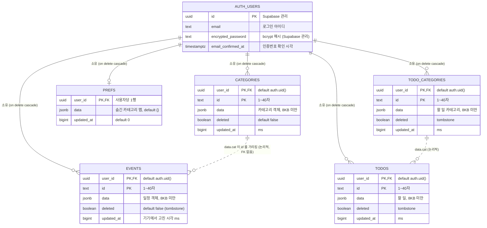
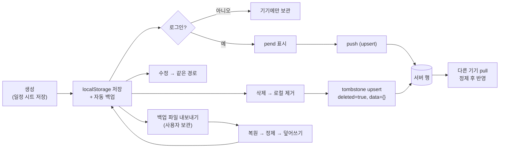

# 04. DB 설계

서버 스키마 원본: [`supabase/schema.sql`](../supabase/schema.sql) (Supabase SQL Editor에서 실행, 재실행 안전)

## 1. 설계 방침

| 방침 | 이유 |
|---|---|
| 항목 1개 = 1행, 본문은 `jsonb data` | 클라이언트 객체 구조가 바뀌어도 스키마 변경 불필요. 검증은 클라이언트 정제 + 크기 제한으로 |
| 기본키 `(user_id, id)` | 사용자마다 같은 id(예: 기본 카테고리 `lec`)를 쓸 수 있게 |
| `updated_at bigint` (ms) | 클라이언트가 고친 시각을 그대로 저장해 LWW 비교 |
| `deleted boolean` | 삭제를 다른 기기로 전파하는 tombstone |
| 접근 제어는 DB에서 | RLS로 `auth.uid() = user_id`만 허용 → 클라이언트 키가 공개돼도 남의 행 접근 불가 |
| 오래된 쓰기 거부도 DB에서 | `keep_newer` 트리거 — 옛 기기가 새 내용을 덮어쓰지 못함 |

## 2. ERD



> `auth.users`는 Supabase Auth가 관리하는 테이블로, 위에는 이 앱과 관련된 컬럼만 개념적으로 표시했다. 앱은 이 테이블에 직접 접근하지 않는다.

## 3. 테이블 정의서

### 3.1 `public.events`

| 컬럼 | 타입 | NULL | 기본값 | 제약 | 설명 |
|---|---|---|---|---|---|
| `user_id` | `uuid` | NOT NULL | `auth.uid()` | PK(1), FK → `auth.users(id)` ON DELETE CASCADE | 소유자 |
| `id` | `text` | NOT NULL | | PK(2), `CHECK (char_length(id) BETWEEN 1 AND 40)` | 클라이언트가 만든 일정 id |
| `data` | `jsonb` | NOT NULL | | `CHECK (pg_column_size(data) < 8192)` | 일정 객체 (§5.1). 삭제 행은 `{}` |
| `deleted` | `boolean` | NOT NULL | `false` | | 삭제 표시 |
| `updated_at` | `bigint` | NOT NULL | | | 기기에서 고친 시각 (Unix ms) |

### 3.2 `public.categories`

| 컬럼 | 타입 | NULL | 기본값 | 제약 | 설명 |
|---|---|---|---|---|---|
| `user_id` | `uuid` | NOT NULL | `auth.uid()` | PK(1), FK → `auth.users(id)` ON DELETE CASCADE | 소유자 |
| `id` | `text` | NOT NULL | | PK(2), `CHECK (char_length(id) BETWEEN 1 AND 40)` | 기본 `lec`/`mtg`/`apt`/`psn`/`etc`, 새 카테고리 `c` + uid |
| `data` | `jsonb` | NOT NULL | | `CHECK (pg_column_size(data) < 8192)` | 카테고리 객체 (§5.2) |
| `deleted` | `boolean` | NOT NULL | `false` | | 삭제 표시 |
| `updated_at` | `bigint` | NOT NULL | | | Unix ms |

### 3.2a `public.todos` · `public.todo_categories` (v45)

둘 다 `events`와 같은 구조(`user_id` · `id` 복합 PK, `data` jsonb < 8KB, `deleted`, `updated_at` ms). RLS `own rows`, `keep_newer` 트리거 동일. `schema.sql` 맨 아래 블록을 SQL Editor에서 실행해 생성.

| 표 | `data` 모양 | 정제 규칙 |
|---|---|---|
| `todos` | `{id, title, cat?, date, done, doneAt?, at, ord?, reopen?}` | `title` 1~100자(빈 제목 버림), `date`는 `YYYY-MM-DD` 필수(없거나 이상하면 버림), `cat`은 `ID_RE`, `done`은 `true`일 때만 완료, `at` = 만든 시각 ms, `ord` = 같은 날 안 순서(끌어서 바꾼 날만 · 0 이상 100만 미만 유한수만 정수로, 아니면 버림 · 날짜를 옮기면 삭제, v48). `data` jsonb라 **스키마 변경 없이** 추가. `reopen` = 지난 시험 · 마감을 직접 다시 해제함(자동 완료 안 함), `true`일 때만 · 안 한 상태일 때만 저장, 날짜를 옮기면 삭제 (v54) |
| `todo_categories` | `{id, name, color, emoji, pin?}` | 일정 카테고리와 같은 `sanitizeCats` + `pin`은 `true`일 때만 |

### 3.3 `public.prefs`

| 컬럼 | 타입 | NULL | 기본값 | 제약 | 설명 |
|---|---|---|---|---|---|
| `user_id` | `uuid` | NOT NULL | `auth.uid()` | PK, FK → `auth.users(id)` ON DELETE CASCADE | 사용자당 1행 |
| `data` | `jsonb` | NOT NULL | `'{}'::jsonb` | `CHECK (pg_column_size(data) < 8192)` | 숨긴 카테고리 맵 (§5.3) |
| `updated_at` | `bigint` | NOT NULL | `0` | | Unix ms |

## 4. 접근 제어 · 트리거

### 4.1 RLS 정책

| 테이블 | RLS | 정책 이름 | 명령 | 대상 롤 | USING | WITH CHECK |
|---|---|---|---|---|---|---|
| `events` | 켜짐 | `own rows` | ALL | `authenticated` | `(select auth.uid()) = user_id` | `(select auth.uid()) = user_id` |
| `categories` | 켜짐 | `own rows` | ALL | `authenticated` | 동일 | 동일 |
| `prefs` | 켜짐 | `own rows` | ALL | `authenticated` | 동일 | 동일 |

| 효과 | 설명 |
|---|---|
| 비로그인(`anon`) | 정책이 `authenticated`에만 있으므로 모든 행 접근 불가 |
| 다른 사용자 행 | SELECT 결과에서 제외, INSERT/UPDATE는 WITH CHECK 위반으로 거부 |
| `user_id` 위조 | 본문에 남의 `user_id`를 넣어도 WITH CHECK에서 거부 |
| `(select auth.uid())` | 행마다 함수를 다시 부르지 않도록 서브쿼리로 감싼 Supabase 권장 형태 |

### 4.2 트리거 `keep_newer`

```sql
create or replace function public.keep_newer() returns trigger
language plpgsql set search_path = '' as $$
begin
  if new.updated_at < old.updated_at then
    return old;      -- 더 예전 시각의 수정이면 무시 (기존 행 유지)
  end if;
  return new;
end $$;
-- BEFORE UPDATE ... FOR EACH ROW 로 events · categories · prefs 에 연결
```

| 항목 | 내용 |
|---|---|
| 시점 | `BEFORE UPDATE` (upsert의 `ON CONFLICT DO UPDATE`도 해당) |
| 효과 | 서버 측 LWW 보장 — 늦게 도착한 옛 수정이 최신 내용을 덮지 못함 |
| `set search_path = ''` | 함수 실행 시 스키마 탐색 경로 고정 (search_path 하이재킹 방지 권장 설정) |
| 같은 시각 | `new.updated_at = old.updated_at`이면 새 값 반영 |

## 5. `data` JSON 형태

클라이언트는 받은 `data`를 그대로 쓰지 않고 아래 정제 함수를 통과시킨다. 정규식: `ID_RE = /^[A-Za-z0-9_-]{1,40}$/`, `COLOR_RE = /^#[0-9A-Fa-f]{6}$/`, `DATE_RE = /^\d{4}-\d{2}-\d{2}$/`.

### 5.1 일정 (`sanitizeEvent`)

| 필드 | 타입 | 필수 | 규칙 | 예 |
|---|---|---|---|---|
| `id` | string | ● | `ID_RE`, 아니면 새 uid 발급 (서버 행은 id 불일치 시 무시) | `"m3k2x9ab1c"` |
| `type` | string | ● | `"lecture"`(매주 반복) 또는 `"appointment"`(특정 날짜), 그 외 → 항목 버림 | `"lecture"` |
| `title` | string | | 최대 100자 (문자열 아니면 `""`) | `"알고리즘"` |
| `location` | string | | 최대 100자 | `"공학관 302호"` |
| `start` | number | ● | 분 단위, `0 ≤ start < end ≤ 1440`, 반올림 | `540` (09:00) |
| `end` | number | ● | 위와 같음 | `630` (10:30) |
| `cat` | string | | `ID_RE` 통과 시만 | `"lec"` |
| `color` | string | | `COLOR_RE` 통과 시만 (없으면 카테고리 색) | `"#8FB3E6"` |
| `days` | int[] | lecture 시 ● | 0~6 정수만 (월=0 … 일=6), 비면 항목 버림 | `[0, 2]` |
| `from` | string | | lecture, `DATE_RE` | `"2026-09-01"` |
| `until` | string | | lecture, `DATE_RE` | `"2026-12-20"` |
| `date` | string | appointment 시 ● | `DATE_RE`, 아니면 항목 버림 | `"2026-11-05"` |

```json
{ "id":"m3k2x9ab1c", "type":"lecture", "title":"알고리즘", "location":"공학관 302호",
  "start":540, "end":630, "cat":"lec", "color":"#8FB3E6", "days":[0,2],
  "from":"2026-09-01", "until":"2026-12-20" }
```

> 정의되지 않은 필드(예: 폐기된 완료 체크의 `doneDates`)는 정제 과정에서 버려진다.

### 5.2 카테고리 (`sanitizeCats`)

| 필드 | 타입 | 필수 | 규칙 |
|---|---|---|---|
| `id` | string | ● | `ID_RE`, 목록 내 중복이면 뒤의 것 버림 |
| `name` | string | ● | 최대 20자 후 trim, 비면 버림 (입력 UI는 `maxlength=10`) |
| `color` | string | ● | `COLOR_RE`, 아니면 기본 팔레트 첫 색 |
| `emoji` | string | | 최대 8자 (UI는 고정 목록 `EMOJIS`에서 선택) |

```json
{ "id":"lec", "name":"강의", "color":"#8FB3E6", "emoji":"📚" }
```

### 5.3 설정 (`prefs.data`)

| 형태 | 규칙 |
|---|---|
| `{ "<카테고리 id>": true, ... }` | 키는 `ID_RE`, 값은 정확히 `true`인 것만 반영 |

### 5.4 백업 파일 (v2, 내보내기 형식)

```json
{
  "app": "weekly-planner",
  "v": 2,
  "exportedAt": "2026-11-03T12:00:00.000Z",
  "events": [ /* 5.1 */ ],
  "categories": [ /* 5.2 */ ],
  "hiddenCats": { "mtg": true }
}
```

| 버전 | 형태 | 복원 처리 |
|---|---|---|
| v1 (예전) | 일정 배열만, 또는 `{events}` | 일정만 정제·복원, 모르는 `cat`은 "복원된 태그"(일정 색)로 생성 |
| v2 | 위 구조 | 일정·카테고리 정제, `hiddenCats`는 값이 `true`이고 존재하는 카테고리만 |

## 6. 클라이언트 `localStorage` 키 목록

| 키 | 내용 | 형식 | 민감도 | 비고 |
|---|---|---|---|---|
| `weekly-planner-events-v1` | 일정 배열 | `Event[]` | 개인정보(일정) | **키 이름 변경 금지** (기존 데이터 호환) |
| `weekly-planner-events-v1-autobak` | 자동 백업 | `{ts, v:1, data: Event[]}` | 개인정보 | 저장할 때마다 덮어씀 |
| `weekly-planner-categories` | 카테고리 | `Category[]` | 낮음 | 비었거나 손상 시 기본 5개 |
| `weekly-planner-hidden-cats` | 숨긴 카테고리 | `{id: true}` | 낮음 | |
| `weekly-planner-meta` | 메타 | `{lastExport: ms}` | 낮음 | 마지막 내보내기 시각 |
| `weekly-planner-mode` | 보기 모드 | `"4"`/`"5"`/`"7"` | 없음 | 그 외 값은 `"4"` |
| `weekly-planner-layout` | 화면 형식 | `"grid"`/`"list"`/`"todo"` | 없음 | 없으면 `"list"`(첫 탭, v57) |
| `weekly-planner-listmode` | 캘린더 탭 보기 (v57) | `"week"`/`"month"` | 없음 | |
| `weekly-planner-todos` | 할 일 (v45) | `[{id,title,cat?,date,done,doneAt?,at,ord?,reopen?}]` | 보통 | 동기화 · 백업 대상 |
| `weekly-planner-todo-cats` | 할 일 카테고리 (v45) | `[{id,name,color,emoji,pin?}]` | 낮음 | 처음 실행 때 일정 카테고리를 복사해 생성, 동기화 · 백업 대상 |
| `weekly-planner-todo-cat` | 마지막에 고른 할 일 카테고리 | `"id"` | 없음 | 다음 추가 때 기본값 (달력 표시 카테고리면 건너뜀, v53) |
| `weekly-planner-ev-dur` | 카테고리별 마지막 일정 길이 (v53) | `{카테고리 id: 분}` | 없음 | 새 일정 종료 시간 기본값. 이 기기에만(동기화 · 백업 안 함), 5~1440분만 사용 |
| `weekly-planner-holidays-{YYYY}` | 공휴일 캐시 | `{fetchedAt, map:{날짜: 이름}}` | 없음 | 14일 지나면 재요청 |
| `weekly-planner-auth` | 세션 | `{access_token, refresh_token, expires_at, user:{id, email}}` | **높음 (토큰)** | 비밀번호는 저장하지 않음. 로그아웃·세션 만료 시 삭제 |
| `weekly-planner-sync` | 동기화 상태 | [03-시스템설계 §3.2](03-시스템설계.md#32-동기화-상태-weekly-planner-sync) | 중간 (일정 사본 포함) | 로그아웃 시 삭제, 세션 만료 시 유지 |
| `weekly-planner-owner` | 이 기기 일정의 주인 uid | `"uuid"` | 낮음 | **로그아웃해도 유지** (다른 계정 합치기 확인용) |

메모리에만 있는 값 (저장 안 함): `recov` (비밀번호 재설정 임시 세션), `codeFor` (인증번호 대상 이메일), 입력 중인 비밀번호.

## 7. 데이터 생명주기



| 이벤트 | 로컬 일정 | 서버 행 | 세션·동기화 키 |
|---|---|---|---|
| 로그아웃 | 유지 | 유지 | `auth`·`sync` 삭제, `owner` 유지 |
| 세션 만료 (refresh 실패) | 유지 | 유지 | `auth` 삭제, `sync` 유지 → 다시 로그인하면 미업로드분 이어서 |
| 다른 계정으로 로그인 (합치기 확인) | 유지 → 새 계정으로 업로드 | 새 계정에 추가 | `owner` = 새 uid |
| 합치기 취소 | 유지 | 변화 없음 | 받은 토큰 폐기, 저장 안 함 |
| iOS 홈 화면 앱 삭제 | **삭제됨** (OS) | 유지 | 삭제됨 |
| 계정 삭제 | — | `ON DELETE CASCADE`로 3개 테이블 행 삭제 | 앱에 탈퇴 기능은 없음 (관리자 대시보드에서만) |
| 일정 삭제 | 즉시 제거 | tombstone 영구 보관 | |
