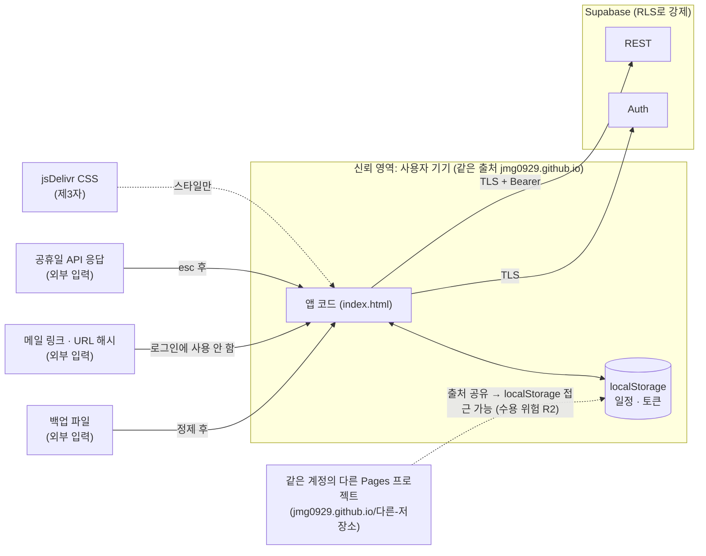
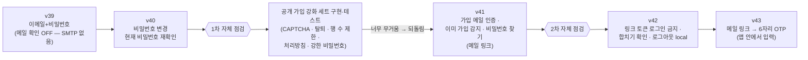
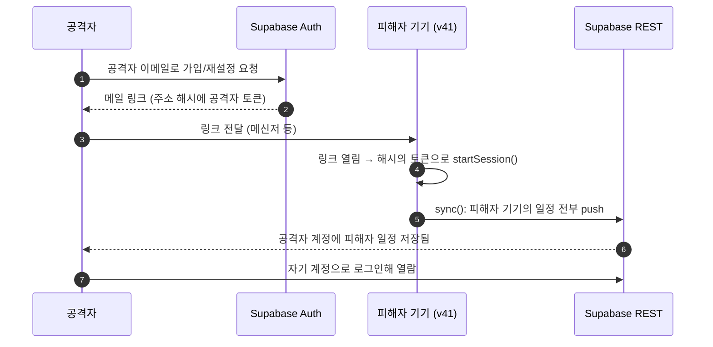

# 07. 보안 설계

> 개인용 경량 앱이라는 전제에서, **무엇을 막았고 무엇을 알고도 받아들였는지**를 근거와 함께 기록한다. 보안 기능은 한 번에 설계된 것이 아니라 기능 추가 → 자체 점검 → 수정을 반복하며 만들어졌다(§4).

## 1. 보호 대상 · 신뢰 경계

| 자산 | 위치 | 중요도 |
|---|---|---|
| 일정 데이터 (제목·장소·시간 = 생활 패턴) | 기기 `localStorage`, Supabase `events` | 높음 |
| 계정 자격 증명 (이메일·비밀번호) | 입력 순간에만 메모리, 서버엔 bcrypt 해시 | 높음 |
| 세션 토큰 (access / refresh) | 기기 `localStorage` `weekly-planner-auth` | 높음 |
| 서버 데이터 무결성 | Supabase | 중간 |
| 카테고리 · 설정 | 기기, 서버 | 낮음 |

## 2. 위협 모델 (STRIDE-lite)

| # | 분류 | 위협 시나리오 | 대응 | 상태 |
|---|---|---|---|---|
| T1 | Spoofing | 비밀번호 추측 · 대입 | Supabase Auth 기본 요청 제한, 로그인 오류 문구 통일 | 부분 대응 (6자 최소 · MFA 없음은 수용) |
| T2 | Spoofing | **로그인 CSRF**: 공격자가 자기 토큰이 든 링크(`#access_token=...`)를 보내 피해자 기기를 공격자 계정으로 로그인시킴 → 피해자 일정이 공격자 계정에 업로드 | 링크 토큰으로는 절대 로그인·동기화하지 않음 (v42) | **해결** (§4.2) |
| T3 | Spoofing | 남의 이메일로 가입 (소유 확인 없음) | 가입 시 메일 인증번호 확인 필수 (v41 링크 → v43 OTP) | 해결 |
| T4 | Tampering | 다른 사용자의 행 수정 · 삽입 (`user_id` 위조) | RLS `USING` + `WITH CHECK` (`auth.uid() = user_id`) | 해결 |
| T5 | Tampering | 오래된 기기가 최신 데이터를 덮어씀 | 서버 `keep_newer` 트리거 + 클라이언트 LWW | 해결 |
| T6 | Tampering → XSS | 악성 백업 파일 · 변조된 서버 행의 id/색/날짜가 `innerHTML` **속성값**에 들어가 스크립트 실행 | `sanitizeEvent`/`sanitizeCats` 정규식 화이트리스트, 텍스트는 `esc()` | 해결 |
| T7 | Tampering → XSS | 공휴일 API 응답 이름에 HTML | `esc()` 후 출력 | 해결 |
| T8 | Info disclosure | 남의 일정 읽기 | RLS (정책은 `authenticated`에만, `anon`은 전부 차단) | 해결 |
| T9 | Info disclosure | 공개 저장소 · 클라이언트 코드의 키 노출 | 클라이언트엔 **publishable 키만**, `service_role` 키는 받지도 쓰지도 않음 | 해결 |
| T10 | Info disclosure | 비밀번호가 기기에 남음 | 입력 후 즉시 칸 비움, 저장하는 것은 토큰뿐 | 해결 |
| T11 | Info disclosure | 계정 존재 여부 확인 (계정 열거) | 로그인 오류 통일, 비밀번호 찾기는 결과와 무관하게 같은 화면 | 부분 (가입 시 "이미 가입된 이메일"은 제품 결정으로 노출) |
| T12 | Info disclosure | **공유 기기 계정 섞임**: A의 일정이 있는 기기에서 B가 로그인 → A 일정이 B 계정으로 | `weekly-planner-owner` 비교 → "이 기기 일정 N개를 OO 계정에 합칠까요?" 확인, 취소 시 로그인 안 함 | **해결** (§4.2) |
| T13 | Info disclosure | 서비스워커가 API 응답(토큰 포함 가능)을 캐시에 영구 저장 | 캐시 대상을 같은 출처 + jsDelivr로 제한, Supabase 요청 `no-store` | 해결 (v39) |
| T14 | Info disclosure | XSS 등으로 `localStorage` 토큰 탈취 | 입력 정제로 XSS 표면 축소. 토큰 저장 방식 자체는 유지 | 수용 (§5) |
| T15 | Info disclosure | 주소창 · 기록에 남은 링크 토큰 | 해시 처리 직후 `history.replaceState`로 제거 | 해결 |
| T16 | Repudiation | 누가 언제 바꿨는지 추적 불가 | 개인 앱, Supabase Auth 로그로 충분 | 수용 |
| T17 | DoS | 한 계정이 대량 행으로 저장소 소모 | 행당 `data` 8KB 미만, id 40자 제한. 사용자별 행 수 제한은 되돌림 | 부분 (수용) |
| T18 | DoS | 봇 대량 가입 | 메일 인증 필수 + Supabase 요청 제한. CAPTCHA는 되돌림. 운영 권고: 본인 가입 후 신규 가입 차단 | 부분 (수용) |
| T19 | Elevation | 트리거 함수의 search_path 하이재킹 | `set search_path = ''` | 해결 |
| T20 | Elevation | 남이 잠깐 폰을 들고 비밀번호 변경 | 변경 전 **현재 비밀번호 재확인** (v40) | 해결 |
| T21 | 기타 | 로그아웃이 다른 기기까지 끊음 / 다른 기기 세션 남김 | `logout?scope=local` — 이 기기 세션만 폐기 (v42) | 해결 (의도한 동작) |

## 3. 구현된 보안 통제

| 영역 | 통제 | 위치 |
|---|---|---|
| 접근 제어 | RLS "own rows" 5개 테이블(`events` · `categories` · `prefs` · `todos` · `todo_categories`), `authenticated` 롤만 | `supabase/schema.sql` |
| 무결성 | `keep_newer` BEFORE UPDATE 트리거, `search_path` 고정 | `schema.sql` |
| 입력 크기 | `id` 1~40자, `data` < 8KB (CHECK) · 클라이언트 제목/장소 100자, 카테고리명 20자, 이모지 8자 | `schema.sql`, `sanitizeEvent`, `sanitizeCats` |
| 출력 인코딩 | `esc()`: `& < > "` 치환, 그 외 텍스트는 `textContent`. `esc()` 없는 `innerHTML`은 Semgrep 사용자 규칙이 CI에서 차단 (2026-11-11) | `index.html`, `.semgrep/planner-xss.yaml` |
| 화이트리스트 | `ID_RE /^[A-Za-z0-9_-]{1,40}$/`, `COLOR_RE /^#[0-9A-Fa-f]{6}$/`, `DATE_RE`, `type ∈ {lecture, appointment}`, `days ⊂ {0..6}`, 시간 `0 ≤ start < end ≤ 1440`, prefs 값 `=== true`, 할 일 `title` 1~100자 · `date` 필수 · `done`/`pin`은 `=== true`만 · `ord`는 0 이상 100만 미만 유한수만 정수로 · `reopen`은 `=== true`만 (`sanitizeTodo`, v45 · v48 · v54) | 백업 복원 · `applyRows` · `pull` |
| 비밀 관리 | publishable 키만 클라이언트에. `service_role` 미사용 — 커밋 직전 훅 · CI gitleaks(전체 이력)로 **자동 강제** (2026-11-11) | `SB_KEY`, `.gitleaks.toml`, [10-DevSecOps](10-DevSecOps-파이프라인.md) |
| 비밀번호 | 기기 미저장, 입력칸 즉시 비움, 서버 bcrypt (Supabase Auth) | `doAuth`, `changePw` |
| 재인증 | 비밀번호 변경 시 현재 비밀번호로 토큰 재발급 후 변경 | `changePw` |
| 이메일 소유 확인 | 가입 · 재설정 모두 6자리 OTP, 5분 만료(서버 300초) | `verifyCode` |
| 링크 토큰 | 로그인에 사용 금지, 가입 링크 토큰은 즉시 폐기, 재설정 토큰은 메모리에서 비밀번호 변경에만 | 해시 처리 IIFE |
| 계정 섞임 방지 | `OWNER_KEY` 비교 + 합치기 확인, 취소 시 받은 세션 폐기 | `startSession` |
| 세션 | 만료 60초 전 갱신, 갱신 실패 시 토큰 삭제, 로그아웃은 `scope=local` | `token`, `acctLogout` |
| 계정 열거 완화 | 로그인 오류 통일, 재설정 요청은 항상 같은 화면 | `authMsg`, `acctForgot` |
| 캐시 | SW 캐시 출처 제한, API `cache: "no-store"` | `sw.js`, `authReq`, `api` |
| 전송 | 모든 통신 HTTPS (GitHub Pages · Supabase) | — |

## 4. 자체 보안 점검 이력

인증 기능은 아래 순서로 발전했다.

### 4.1 1차 점검 — "공개 서비스라면?" 관점

| 지적 | 1차 대응 (구현 · 테스트) | 최종 결정 |
|---|---|---|
| 메일 확인 없이 아무 이메일로 가입 가능 | 메일 인증 | **채택** (v41, v43에서 OTP로) |
| 봇 대량 가입 | Cloudflare Turnstile CAPTCHA | 되돌림 |
| 사용자가 데이터를 지울 방법 없음 | 회원 탈퇴 RPC | 되돌림 |
| 한 계정이 저장소를 무한히 사용 | 사용자별 행 수 제한 | 되돌림 (행 크기 제한은 유지) |
| 개인정보 처리 고지 없음 | 개인정보 처리방침 페이지 | 되돌림 |
| 약한 비밀번호 허용 | 강한 비밀번호 규칙 | 되돌림 (6자 최소 유지) |
| 비밀번호 분실 시 복구 수단 없음 | 비밀번호 찾기 | **채택** (v41, v43에서 OTP로) |

**트레이드오프**: 실제 사용자는 본인 한 명이고 목표는 "가벼운 앱"이었다. 강화 세트는 가입 화면과 운영 부담(CAPTCHA 키, RPC, 문서 관리)을 크게 늘렸다. 그래서 **위협을 문서화하고 운영으로 완화**(본인 가입 후 Supabase에서 신규 가입 차단 권고)하는 쪽을 택했고, 코드는 배포 전에 되돌렸다(저장소 이력에 없음). 무거운 보안 기능은 앞으로도 **먼저 제안 → 동의 후 구현** 원칙.

### 4.2 2차 점검 — 로그인 CSRF · 계정 섞임

#### 발견 1: 메일 링크 토큰을 이용한 로그인 CSRF (v41)

v41은 가입 인증 · 비밀번호 재설정 메일의 **링크**로 앱이 열리면, 주소 해시의 `access_token`으로 사용자 정보를 확인한 뒤 곧바로 `startSession()`을 호출했다(로그인 + 동기화 시작).

| 항목 | 내용 |
|---|---|
| 유형 | Login CSRF (세션 고정과 유사) — 피해자가 **자기도 모르게 공격자 계정으로 로그인** |
| 영향 | 피해자 일정(생활 패턴·장소) 유출, 이후 피해자가 입력하는 일정도 계속 공격자 계정으로 |
| 원인 | 출처를 검증할 수 없는 외부 입력(URL 해시)의 토큰을 **세션으로 신뢰** |
| 수정 (v42) | ① 가입 링크 토큰: `logout?scope=local`로 **폐기만** 하고 "메일 인증 완료 · 로그인해 주세요" ② 재설정 링크 토큰: `recov`(메모리)에만 두고 비밀번호 변경에만 사용 → 변경 후 폐기 → 새 비밀번호로 **직접 로그인** ③ 해시는 즉시 주소에서 제거 |
| 추가 완화 | 재설정 화면에 토큰 주인의 **이메일을 표시** → 남의 계정이면 사용자가 알아챔 |
| 검증 | TC-25 · TC-26: 공격자 토큰 링크로 열어도 **데이터 요청 0건**, 로그인 상태 아님 |

#### 발견 2: 공유 기기에서 계정 섞임

| 항목 | 내용 |
|---|---|
| 시나리오 | A의 일정이 있는 기기(가족 PC 등)에서 B가 로그인 → 처음 로그인 합치기 규칙에 따라 A 일정이 B 계정으로 업로드 |
| 수정 (v42) | `weekly-planner-owner`(이 기기 일정의 주인 uid, 로그아웃해도 유지)와 로그인 계정이 다르고 기기에 일정이 있으면 확인 대화상자. **취소 시 받은 세션을 `scope=local`로 폐기**하고 아무것도 올리지 않음 |
| 함께 바꾼 것 | 로그아웃을 기본(전체) → `scope=local`(이 기기만)로. 기기 일정은 남김 |
| 검증 | TC-27: 확인 → 합쳐짐 / 취소 → 로그인 안 됨 · 업로드 0건 |

#### 후속: 링크 → 6자리 OTP (v43)

iOS 홈 화면 앱과 Safari는 저장 공간이 달라 메일 링크가 엉뚱한 곳(Safari)에서 열렸다. 앱 안에서 입력하는 **6자리 인증번호**(`POST /auth/v1/verify`, `type=email|recovery`)로 바꾸면서, 링크 토큰이라는 공격 표면 자체가 정상 흐름에서 사라졌다. 링크 해시 처리 코드는 예전 메일을 위한 호환용으로 남겼고, v42의 "로그인 금지" 규칙을 그대로 따른다.

## 5. 수용한 위험 (Accepted Risks)

| # | 위험 | 이유 | 완화 · 조건 |
|---|---|---|---|
| R1 | 토큰을 `localStorage`에 저장 (XSS 시 탈취 가능) | 서버 없는 정적 앱에서 HttpOnly 쿠키 불가, 로그인 유지 요구 | 입력 정제로 XSS 표면 축소, 외부 스크립트 없음 |
| R2 | 공유 출처 `jmg0929.github.io` (같은 계정의 다른 Pages 프로젝트와 출처 공유) | GitHub Pages 무료 호스팅 | 같은 사용자 서브도메인에 신뢰할 수 없는 코드를 올리지 않음. 필요 시 커스텀 도메인 |
| R3 | CSP 없음 | GitHub Pages는 응답 헤더 설정 불가. 인라인 스크립트·스타일 구조 | `<meta http-equiv="Content-Security-Policy">` 도입은 향후 과제 |
| R4 | MFA 없음 | 개인 일정 앱, 사용성 우선 | 강한 비밀번호 사용 권장 |
| R5 | 회원 탈퇴 기능 없음 | 강화 세트에서 되돌림 | 관리자가 대시보드에서 삭제 → `ON DELETE CASCADE`로 데이터 삭제 |
| R6 | 비밀번호 최소 6자 | Supabase 기본값, 가벼운 가입 | 서버 설정으로 언제든 강화 가능 |
| R7 | 가입 시 "이미 가입된 이메일" 안내 (계정 존재 노출) | 본인이 헷갈리지 않게 하는 제품 결정 | 로그인·재설정에서는 노출하지 않음 |
| R8 | CAPTCHA · 사용자별 행 수 제한 없음 | 강화 세트에서 되돌림 | 메일 인증 필수 + 행 크기 제한 + (운영) 신규 가입 차단 권고 |
| R9 | 외부 CDN CSS (jsDelivr) | 한글 글꼴 품질 | 스타일시트만(스크립트 아님), 버전 고정 `@v1.3.9` (SRI 해시는 미적용) |
| R10 | 기기 시계 기준 `updated_at` | 단순한 LWW | 시계 조작 = 본인 데이터만 영향 (RLS) |

## 6. 운영 보안 설정 (Supabase 대시보드 — 저장소 밖)

| 설정 | 값 / 권고 | 비고 |
|---|---|---|
| Confirm email | ON | v39 당시 SMTP가 없어 OFF였음 |
| SMTP | 사용자 SMTP 연결 (메일 발송) | 계정 비밀번호가 아닌 앱 전용 비밀번호 사용 |
| 메일 템플릿 | 인증번호(`Token`) 포함 | OTP 방식 |
| Email OTP 만료 | 300초 | 앱 타이머 5분과 일치 |
| Site URL / Redirect URL | 앱 주소 | 호환용 링크 처리 |
| Allow new users to sign up | **본인 가입 후 OFF 권고** | 봇 가입 · 저장소 남용 차단 (R8 완화) |
| API 키 | publishable 키만 앱에, `service_role`은 대시보드 밖으로 꺼내지 않음 | |

> 위 항목은 대시보드 설정이라 저장소 코드로는 검증할 수 없다. 앱 코드가 기대하는 값을 기록한 것이다.

## 7. 향후 과제

| 우선 | 과제 | 기대 효과 |
|---|---|---|
| 높음 | 신규 가입 차단 (운영 설정) | R8 실질 해소 |
| 높음 | `<meta>` CSP (`script-src 'self'` + 해시, `connect-src` Supabase · Nager · jsDelivr) | R1 · R3 완화 |
| 중간 | 외부 CSS에 SRI(`integrity`) 또는 글꼴 자체 호스팅 | R9 완화 |
| 중간 | 커스텀 도메인으로 출처 분리 | R2 해소 |
| 중간 | 회원 탈퇴 (본인 데이터 삭제) | R5, 개인정보 자기결정권 |
| 낮음 | tombstone 정리 · 사용자별 행 수 상한 | 저장소 관리 |
| 낮음 | 비밀번호 정책 강화 / 선택적 MFA | R4 · R6 |
| 중간 | RLS 자동 테스트 (로컬 Supabase), ZAP 주간 스캔, 배포 승인 게이트 | DevSecOps 2 · 3단계 ([10](10-DevSecOps-파이프라인.md#8-한계--다음-단계)) |
