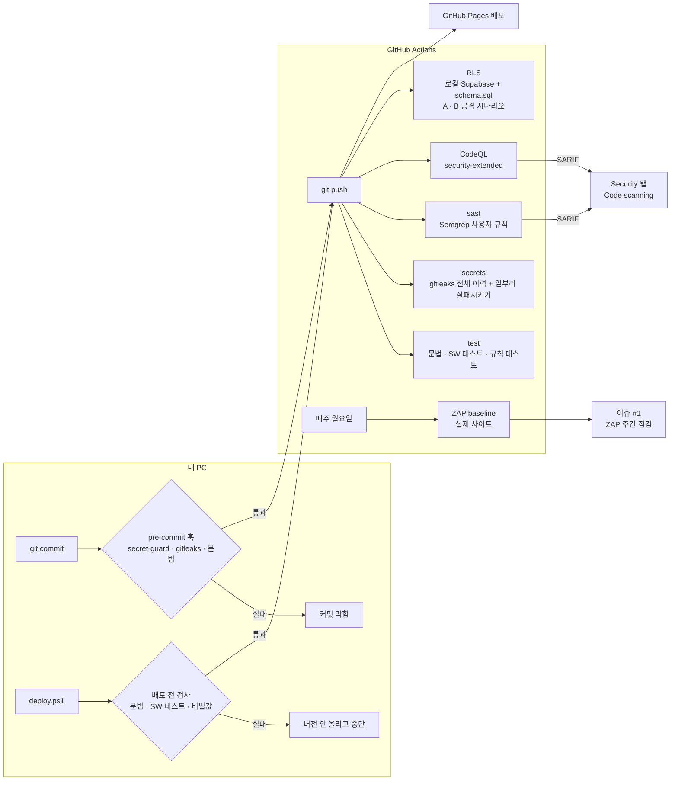

# 10. DevSecOps 파이프라인 — 1단계 CI 보안 자동화 · 2단계 클라우드 권한 · 실행 중 점검

> 사람이 "기억해서" 하던 검사를 **코드로 강제**한다. 커밋 직전(내 PC) → push 직후(GitHub Actions) → 배포 직전(`deploy.ps1`) 세 곳에서 같은 규칙을 검사한다.
> 도입: 2026-11-11 — 1단계 `be7a5d5`, 2단계 `525fb57` · 앱 코드(`index.html`)는 바꾸지 않음 → 캐시 버전 그대로
> 2단계 요약: **RLS 공격 시나리오 56/56 차단** (CI 안 로컬 Supabase), 발견 사항 **F-01** 재현 · **ZAP 첫 스캔 경고 21종(규칙 16개) → 판정표**(고칠 일 3 · 수용 8 · 무시 5)

## 1. 왜 만들었나

| 이전 상태 | 위험 | 1단계에서 바꾼 것 |
|---|---|---|
| 문법 검사 · 서비스워커 테스트를 **수동**으로 실행 ([08-테스트 §4](08-테스트.md#4-회귀-테스트-방법)) | 깜빡하면 깨진 코드가 그대로 배포 | push마다 CI가 자동 실행, 배포 스크립트도 실패 시 중단 |
| "service_role 키는 쓰지 않는다"가 **문서의 약속**뿐 ([07-보안설계 §3](07-보안설계.md#3-구현된-보안-통제) 비밀 관리) | 실수로 서버 키를 커밋하면 공개 저장소에 영구 노출 → RLS 무력화 | 커밋 직전 · CI 두 겹의 비밀값 검사 |
| XSS 방어(`esc()` · 정제 함수)가 **코드 리뷰 습관**에 의존 (위협 T6) | 새 화면을 만들 때 `esc()` 하나만 빠져도 저장형 XSS | 이 프로젝트 전용 Semgrep 규칙으로 `esc()` 없는 `innerHTML`을 차단 |

## 2. 전체 흐름

> 지금은 검사와 Pages 배포가 **나란히** 돈다 (검사가 실패해도 배포는 됨). 검사 통과 → 승인 → 배포 순서의 게이트는 3단계에서 Pages 배포를 Actions로 옮기며 적용 (§8).

## 3. 구성 요소

| 단계 | 도구 | 막는 것 | 관련 위협 | 파일 |
|---|---|---|---|---|
| 커밋 직전 | `secret-guard.js` (Node, 설치 불필요) + gitleaks(설치돼 있으면) | 서버 키 · 개인 키 · AWS · GitHub 토큰 커밋 | 비밀 노출 | `.githooks/pre-commit`, `scripts/secret-guard.js` |
| CI `test` | Node 24 | 스크립트 문법 오류, manifest 형식, SW 캐시 범위(TC-14), 비밀값 규칙 회귀 | 가용성 · B-03 회귀 | `scripts/check-syntax.js`, `tests/*.test.js` |
| CI `secrets` | gitleaks 8.30.1 | **전체 이력**의 비밀값 (지운 커밋 포함) | 비밀 노출 | `.gitleaks.toml` |
| CI `sast` | Semgrep 1.182.1 사용자 규칙 3개 | `esc()` 없는 `innerHTML`, `eval` 류, 클라이언트의 서버 키 | T6 (XSS) | `.semgrep/planner-xss.yaml` |
| CodeQL | GitHub CodeQL `security-extended` | 일반 JS 취약점 패턴 (DOM XSS, 안전하지 않은 정규식 등) | 전반 | `.github/workflows/codeql.yml` |
| 배포 직전 | `deploy.ps1` 1.5단계 | 위 검사를 통과하지 못한 배포 | — | `deploy.ps1` |

## 4. 비밀값 검사

### 4.1 규칙
| 규칙 | 찾는 것 | 비고 |
|---|---|---|
| gitleaks 기본 규칙 전체 | 클라우드 · SaaS 토큰 등 | `useDefault = true` |
| `supabase-secret-key` (추가) | `sb_secret_…` | 새 형식 서버 키 — RLS 무시 |
| `supabase-service-role-jwt` (추가) | JWT 본문에 `"role":"service_role"` | base64 정렬 3가지(`c2VydmljZV9yb2xl` · `NlcnZpY2Vfcm9sZ` · `zZXJ2aWNlX3JvbG`)를 모두 찾음 |
| `secret-guard.js` | 위 2개 + 개인 키 · AWS · GitHub 토큰 | JWT는 **실제로 디코딩**해서 `role`을 확인 → anon 키는 통과 |

### 4.2 처음 돌렸을 때: 1건 → 검토 → 좁은 예외
| 항목 | 내용 |
|---|---|
| 발견 | 기본 규칙 `generic-api-key`가 `index.html`의 `SB_KEY`(커밋 `89f1255`부터) 탐지 |
| 판단 | publishable 키 = 브라우저로 내려가는 **공개값**. 권한은 서버 RLS가 막음 ([07-보안설계](07-보안설계.md)). 유출 아님 |
| 조치 | 예외를 **값의 형식** `sb_publishable_…`으로만 좁게 등록 (파일 · 규칙 전체 예외 X), 근거를 설정 파일 주석에 기록 |
| 결과 | 커밋 50개 전체 이력 → 0건 |

### 4.3 "검사가 고장 나서 조용히 통과"하는 것을 막기 (canary)
CI가 실행될 때마다 임시 폴더에 **가짜 서버 키를 만들어** gitleaks에 넣고, 종료 코드 42(유출 발견)가 나와야만 통과한다. 규칙 파일이 깨지거나 예외가 너무 넓어지면 이 단계가 빨간불이 된다. 가짜 키는 실행 중에만 만들어서 저장소에는 키 모양 문자열이 없다 (`tests/secret-guard.test.js`도 같은 방식).

## 5. Semgrep 사용자 규칙 — "이 프로젝트의 약속"을 코드로

### 5.1 규칙
| ID | 방식 | 내용 |
|---|---|---|
| `planner-innerhtml-unescaped` | **taint(데이터 흐름) 분석** | 출처(`.title` · `.name` · `.location` · `.emoji` · `.email` · 입력칸 `.value` · `location.hash` · `localStorage.getItem`)가 `esc()`를 거치지 않고 `innerHTML` · `outerHTML` · `insertAdjacentHTML` · `document.write`에 닿으면 오류. `h += …` 누적, `forEach` 안 누적, `list.map(…).join("")` 콜백 반환값까지 추적 |
| `planner-string-to-code` | 패턴 | `eval`, `new Function`, 문자열 `setTimeout/setInterval` |
| `planner-server-key-in-client` | 정규식 | 클라이언트 코드의 `service_role` · `sb_secret_` |

### 5.2 규칙도 테스트한다
`.semgrep/planner-xss.js`에 `// ruleid:`(잡아야 함) · `// ok:`(잡으면 안 됨) 표시를 단 예제(잡아야 할 8곳 · 잡으면 안 되는 7곳) — `index.html`의 실제 모양(이어 붙이기 · 루프 누적 · `map().join` · `esc()` 감싼 경우 · 숫자만 넣는 경우 · `textContent`)을 흉내 냄. CI에서 `semgrep --test`로 규칙이 바뀔 때마다 확인.

### 5.3 실제 코드에 처음 돌렸을 때: 오탐 3건 → 원인 분석 → 근거를 남긴 예외
| 위치 | 탐지 | 원인 | 판정 |
|---|---|---|---|
| `index.html` 2132 · 2644 (최근 입력 목록) | `box.innerHTML = list.map(…)` | `list = recentFrom(…, 입력칸.value)` — Semgrep은 "오염된 값을 인자로 받은 함수의 결과도 오염"으로 봄 | `recentFrom`은 입력을 **검색어로만** 쓰고 저장된 항목을 돌려줌. 항목 제목은 그리는 곳에서 `esc()` → 안전 |
| 2422 (카테고리 편집 목록) | `catList.innerHTML = h` | `h += emoGrid(editCat.emoji)` | `emoGrid`는 고정 목록 `EMOJIS`로만 버튼을 만들고 인자는 "선택됨" 비교에만 씀 → 안전 |

조치: 두 함수를 규칙의 sanitizer로 등록하고 **검토 날짜 · 근거를 규칙 파일에 주석으로** 남김 (코드에 `nosemgrep`을 흩뿌리지 않음). 검토 중 `map()` 콜백 반환값을 놓치는 규칙 결함도 발견해 sink를 보강 → 규칙 테스트 3/3 통과, 실제 코드 0건.

### 5.4 진짜로 잡는지 확인 (변이 테스트)
검사용 사본에서 카테고리 필터의 `esc(c.name)` 하나를 `c.name`으로 바꾸자 **1건 탐지** — 보고된 줄 번호 2359가 `index.html`의 `menuFilterEl.innerHTML=h;`와 정확히 일치.

### 5.5 HTML 안 스크립트를 검사하는 방법
Semgrep은 `.html` 안의 `<script>`를 읽지 못함 → `scripts/extract-inline-js.js`가 스크립트를 꺼내면서 **앞에 빈 줄을 채워 줄 번호를 `index.html`과 같게** 만듦. CI는 SARIF 결과의 파일 경로만 `index.html`로 바꿔 Security 탭에 올림 → 경고를 누르면 원본 줄로 바로 이동. 문법 검사(`node --check`) 오류 줄 번호도 같은 방식으로 원본과 일치.

## 6. 공급망 보안 · 최소 권한

| 항목 | 적용 |
|---|---|
| Action 고정 | 태그(`@v7`)가 아니라 **커밋 해시**로 고정, 옆에 버전 주석. 태그는 옮겨질 수 있음 |
| 버전 쿨다운 | 공개된 지 **2주 이상** 지난 버전만 사용 (CodeQL Action v4.39.0 · Semgrep 1.182.1 — 더 새 버전이 있었지만 갓 나온 버전은 제외) |
| 도구 무결성 | gitleaks는 공식 릴리스 + **SHA-256 체크섬 확인** 후 설치 |
| 토큰 권한 | 워크플로 기본 `contents: read`, Security 탭에 올리는 job만 `security-events: write` |
| 자격 증명 | `checkout`에 `persist-credentials: false` — 이후 단계가 저장소 토큰을 쓰지 못함 |
| 동시 실행 | `concurrency` + `cancel-in-progress`로 같은 브랜치의 이전 실행 취소 |
| 외부 전송 | `SEMGREP_SEND_METRICS=off`, `--metrics=off` |

## 7. 검증 결과

| 검증 | 결과 |
|---|---|
| 문법 검사 | index.html 스크립트 2개 · sw.js · manifest 통과 |
| 서비스워커 테스트 (TC-14) | 8/8 통과 |
| `secret-guard` 규칙 테스트 | 9/9 (잡아야 할 6 · 통과시켜야 할 3) |
| gitleaks 전체 이력 | 커밋 50개 · 0건 (예외 등록 후) |
| gitleaks canary | 가짜 키 4종(새 형식 1 + JWT 정렬 3) 모두 탐지, 기본 `jwt` 규칙과 함께 7건 |
| pre-commit 훅 | 임시 저장소에서 가짜 서버 키를 스테이징 → 커밋 막힘, 값은 출력하지 않고 파일:줄 · 규칙만 표시 |
| Semgrep 규칙 테스트 | 3/3 규칙 통과 |
| Semgrep 실제 코드 | 0건 (오탐 3건 검토 후) · 변이 테스트 1건 탐지 |
| `deploy.ps1 -DryRun` | 배포 전 검사 단계 통과 |
| GitHub Actions 첫 실행 | (아래 §7.1) |

### 7.1 GitHub Actions 첫 실행 (커밋 `be7a5d5`, 2026-11-11)

| 워크플로 · job | 결과 | 걸린 시간 | 비고 |
|---|---|---|---|
| CI · 문법 · 테스트 | 성공 | 6초 | 문법 · TC-14 · secret-guard 규칙 테스트 |
| CI · 비밀값 검사 (gitleaks) | 성공 | 7초 | 체크섬 확인 설치 → 전체 이력 0건 → canary 탐지 확인 |
| CI · 정적 분석 (Semgrep) | 성공 | 32초 | 규칙 테스트 → 검사 0건 → SARIF를 Security 탭에 업로드 |
| CodeQL (javascript) | 성공 | 65초 | `security-extended` 분석 완료. 경고 목록은 저장소 주인만 보는 Security 탭에서 확인 |
| (기존) GitHub Pages 배포 | 성공 | — | 검사와 나란히 실행 |

## 8. 한계 · 다음 단계

| 항목 | 현재 | 다음 |
|---|---|---|
| 배포 게이트 | 검사와 Pages 배포가 나란히 실행 | **3단계**: Pages 배포를 Actions로 옮겨 `검사 통과 → Environment 승인(Required reviewers) → 배포`, main 브랜치 보호 |
| Semgrep 범위 | 클라이언트 JS taint는 함수 안(intraprocedural)만 추적 | 새 화면 패턴이 생기면 테스트 예제부터 추가 |
| 서버(클라우드) 설정 | ~~RLS는 SQL 파일 + 수동 확인~~ | **2단계 완료** (§9). 남은 일: F-01 완화(서버 시각 상한) — 운영 DB 적용은 대시보드에서 직접 |
| 실행 중 앱 점검 | ~~없음~~ | **2단계 완료** (§10). 남은 일: ZAP의 고칠 일 3건 — `<meta>` CSP · 글꼴 CSS SRI(앱 코드 수정이라 기능 작업과 맞춰서) · 클릭재킹(커스텀 도메인 필요) |
| 커밋 직전 훅 | 저장소마다 `git config core.hooksPath .githooks` 한 번 필요 | — (안 켜도 CI에서 다시 걸림) |

## 9. 2단계 — 클라우드 권한 자동 테스트 (RLS)

### 9.1 방식
| 항목 | 내용 |
|---|---|
| 환경 | GitHub Actions 안에서 **Supabase CLI 2.122.0**으로 로컬 Supabase를 띄움 (DB · 인증 · REST · 게이트웨이만, 나머지 10개 서비스 제외 → 약 110초) |
| 스키마 | 운영에 적용하는 `supabase/schema.sql`을 **그대로 두 번** 적용 — "여러 번 실행해도 안전"이라는 주석을 테스트로 확인 |
| 공격 경로 | 앱과 똑같이 **REST API(PostgREST) + 사용자 토큰**으로 요청. DB에 직접 붙지 않음 → 실제 공격자가 쓸 수 있는 경로 그대로 |
| 운영 서버 | 접속하지 않음. 키 · 비밀번호 · 비밀값 불필요 (로컬 키는 실행 중에만 생기고 로그에서 가림) |
| 언제 | `supabase/` · 테스트 파일이 바뀔 때, 매주 월요일 (Supabase 이미지가 바뀌어도 권한이 그대로인지) |

### 9.2 설정 점검 (`tests/rls/rls-config.sql`) — "새 테이블에 RLS를 깜빡"하는 실수를 막음
| 점검 | 결과 |
|---|---|
| public 테이블 중 RLS가 꺼진 것 | 없음 (5개 모두 켜짐) |
| RLS는 켰지만 정책이 없는 테이블 | 없음 |
| `anon` · `public` 롤에 열린 정책 | 없음 |
| 읽기(`using`) · 쓰기(`with check`) 양쪽에 `auth.uid()` 본인 확인 | 모두 있음 |
| `search_path`가 고정되지 않은 함수 (스키마 바꿔치기) | 없음 (`keep_newer`는 `set search_path = ''`) |

### 9.3 공격 시나리오 (`tests/rls/rls.test.js`) — 56/56 통과
사용자 A · B를 가입시키고, 표 4개(`events` · `categories` · `todos` · `todo_categories`)마다 13개 + `prefs` 4개.

| # | 시나리오 (B = 공격자) | 기대 | 결과 |
|---|---|---|---|
| 01 | A가 자기 행 upsert (앱과 같은 방식) | `user_id`가 자동으로 A | ✅ ×4 |
| 02 · 03 | B가 전체 조회 / A의 `user_id`로 필터 | A 행 0개 | ✅ ×8 |
| 04 · 05 | B가 A 행 수정 / 삭제 | 0행 반영, A 데이터 그대로 | ✅ ×8 |
| 06 | B가 `user_id=A`로 새 행 심기 | 거부 (RLS `with check`) | ✅ ×4 |
| 07 | B가 A 행의 키로 upsert 덮어쓰기 | 거부, A 데이터 그대로 | ✅ ×4 |
| 08 | A가 자기 행을 B에게 넘기기 (`user_id` 변경) | 거부 | ✅ ×4 |
| 09 · 10 | 로그인 안 한 요청(anon) 조회 / 쓰기 | 데이터 없음 / 거부 | ✅ ×8 |
| 11 | 더 옛 시각의 수정 (오래된 기기) | 무시 (`keep_newer`) | ✅ ×4 |
| 12 · 13 | `data` 8KB 초과 / `id` 41자 | 거부 (CHECK) | ✅ ×8 |
| P-01~04 | `prefs` 본인 쓰기 · B 조회 · B 수정 · B upsert | 본인만 | ✅ ×4 |

### 9.4 발견 사항 F-01 — 미래 시각으로 저장된 행이 잠김 (수용 위험 R10의 실제 영향)
| 항목 | 내용 |
|---|---|
| 재현 | A가 `updated_at`을 100년 뒤로 저장 → 이후 정상 시각의 수정이 **모두 무시**됨 (CI 경고로 매번 표시) |
| 원인 | `keep_newer`는 "더 옛 시각이면 무시"만 보고 시각의 **상한**을 보지 않음. 시각은 기기 시계 기준 (R10) |
| 영향 | RLS 덕분에 **본인 계정 데이터에만** 영향 (다른 사용자 공격 불가). 다만 시계가 크게 앞선 기기 하나가 그 항목을 **다른 모든 기기에서 고칠 수 없게** 만들 수 있음 — R10의 "본인 데이터만 영향"보다 구체적인 영향 |
| 완화안 | 트리거에서 `updated_at`을 서버 시각 + 5분으로 제한. 운영 DB는 대시보드 SQL Editor에서 직접 실행해야 하고, 앱의 동기화 비교 로직과 맞물리는지 확인이 필요해 **별도 작업으로 보류** |

## 10. 2단계 — 실행 중 사이트 점검 (DAST, OWASP ZAP)

### 10.1 방식
| 항목 | 내용 |
|---|---|
| 도구 | `zaproxy/action-baseline` v0.15.0 (커밋 해시 고정) + ZAP 이미지 **다이제스트 고정** (2026-10-26 빌드) |
| 범위 | 배포된 `https://jmg0929.github.io/weekly-planner/`만. baseline = 크롤링 + **수동(passive) 검사** — 공격 요청을 보내지 않음. 로그인 · Supabase는 스캔하지 않음 |
| 주기 | 매주 월요일 + 판정표(`.zap/rules.tsv`) · 워크플로가 바뀔 때 |
| 결과 | 이슈 하나("ZAP 주간 점검", #1)를 매번 갱신 + 보고서 파일(artifact) |

### 10.2 첫 스캔 판정 (경고 21종 → `.zap/rules.tsv`)
| 판정 | 경고 | 근거 · 연결 |
|---|---|---|
| **고칠 일 (WARN)** | CSP 헤더 없음 (10038) | GitHub Pages는 응답 헤더 설정 불가 → `<meta>` CSP로 보완 (R3, 백로그 높음) |
| | 외부 CSS SRI 없음 (90003) | jsDelivr 글꼴 CSS에 `integrity` 추가 (R9) |
| | 클릭재킹 방지 헤더 없음 (10020) | `frame-ancestors`는 `<meta>`로 불가 → 커스텀 도메인 · 프록시 필요 (새 수용 위험 R11 후보) |
| **수용 (INFO)** | Permissions-Policy · X-Content-Type-Options · COOP/COEP · `Access-Control-Allow-Origin: *` | 모두 **헤더 설정이 불가한 플랫폼 한계**. 앱이 해당 기능(권한 API · 교차 출처 격리)을 쓰지 않거나, 공개 정적 파일이라 영향 낮음 |
| | Base64 문자열 · 주석의 의심 단어 | 공개값(publishable 키 · 아이콘) · 한국어 개발 주석 — 비밀이 아님은 1단계 gitleaks로 확인 |
| | CSP 세부 · HSTS | `jmg0929.github.io` 루트 · `robots.txt` · `sitemap.xml` = **이 앱이 아닌 GitHub 404 페이지** (범위 밖) |
| **무시 (IGNORE)** | 캐시 관련 3종 · Sec-Fetch-* · Modern Web App | CDN 캐시는 의도된 동작(응답에 개인 데이터 없음), Sec-Fetch-*는 스캐너 자신의 요청 특성, 정보 제공용 |

> 판정 원칙: **근거 없는 IGNORE 금지**. 고칠 수 있는 것은 WARN으로 남겨 매주 이슈에 계속 보이게 하고, 플랫폼 한계는 [07-보안설계 §5 수용 위험](07-보안설계.md#5-수용한-위험-accepted-risks)과 연결.
