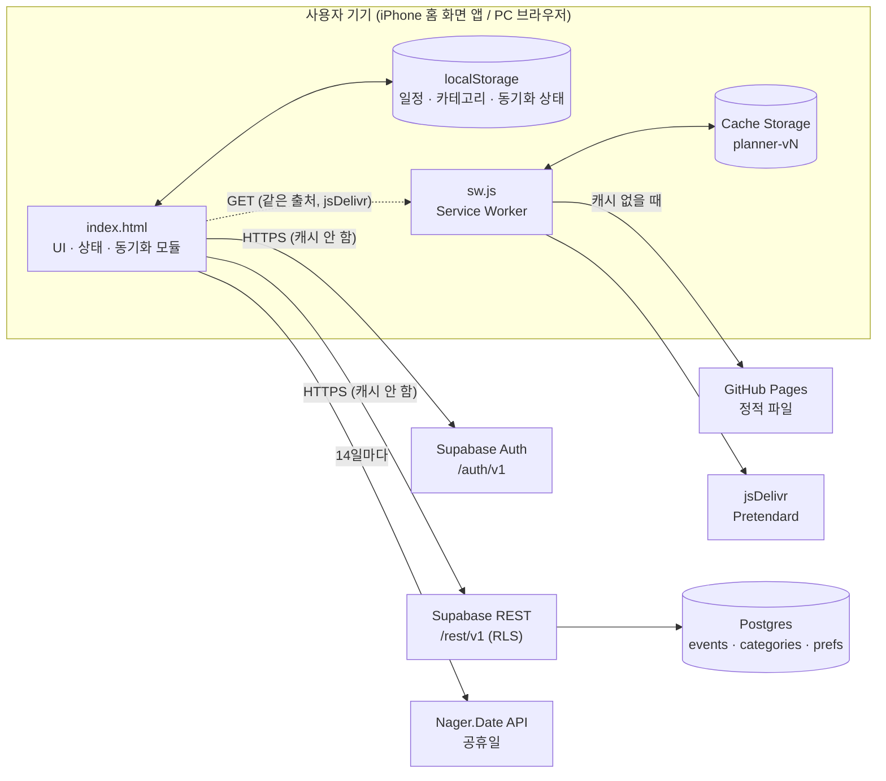
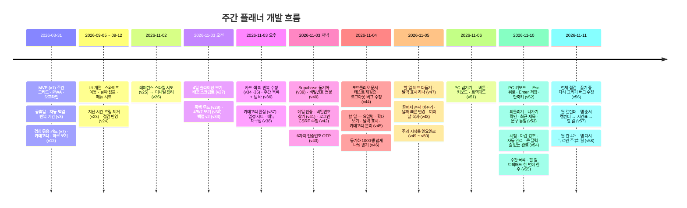

# 주간 플래너 (Weekly Planner) — 개발 포트폴리오

> 아이폰 홈 화면에 설치해 쓰는 **시간표형 주간 플래너 PWA**.
> 프레임워크·빌드 없이 단일 `index.html`로 만들고, 로컬 우선(local-first) 동기화와 단계적으로 강화한 인증을 붙인 개인 프로젝트.

| 항목 | 내용 |
|---|---|
| 서비스 주소 | https://jmg0929.github.io/weekly-planner/ |
| 저장소 | `jmg0929/weekly-planner` (GitHub, Public) |
| 개발 기간 | 2026-08-31 ~ 2026-11-11 (커밋 52개, 서비스워커 캐시 `planner-v1` → `planner-v58`) |
| 개발 형태 | 1인 개발 (기획·디자인·구현·테스트·배포), 실사용자 = 본인 |
| 규모 | `index.html` 약 3,320줄 (HTML·CSS·JS 한 파일), `sw.js` 48줄, `supabase/schema.sql` 94줄 |

---

## 1. 문제와 목표

| 구분 | 내용 |
|---|---|
| 문제 | 기본 캘린더 앱은 "월 단위·목록형"이라 **매주 반복되는 강의 시간표 + 그 사이의 약속**을 한눈에 보기 어려움. 시간표 앱은 약속·개인 일정을 넣기 불편함 |
| 목표 1 | 폰 세로 화면에서 **며칠~일주일을 시간 축으로** 한 번에 보기 |
| 목표 2 | 설치형 앱처럼 빠르고, **인터넷 없이도** 동작 |
| 목표 3 | 폰 ↔ PC에서 **같은 일정**을 보고 고치기 (서버는 무료·경량) |
| 목표 4 | 시큐어 코딩 수업 내용을 실제 서비스에 적용: XSS 방어, RLS, 인증 흐름 위협 분석 |
| 비목표 | 다중 사용자 협업, 알림(Web Push), 외부 캘린더 연동 — 백로그로 분리 |

## 2. 주요 기능

| 기능 | 설명 | 관련 문서 |
|---|---|---|
| 시간표 보기 | 4일 → 5일 → 주(7일) 보기 순환, N일 보기는 오늘부터 하루씩 미끄러지는 창 + 다음 날 흐린 미리보기, 주는 일요일 시작, PC는 `‹ ›` · ← → · 트랙패드로 넘기기, Esc · Enter · N · T · 1~3 키보드 조작 | [요구사항](01-요구사항정의서.md) |
| 하루 크게 보기 | 요일 헤더 탭 → 그날 1열 확대 (장소·시간까지 표시) | [화면흐름](02-유스케이스-화면흐름.md) |
| 캘린더 (주 · 월) | 탭 바 첫 번째. 주: 2×4 그리드 + 미니 달력, 월: 일정 띠 · 데드라인 체크 네모 칸 + 고른 날 목록(시간 · 색 막대 · 제목) | [UX/UI](06-UXUI설계.md) |
| 할 일 (요일별 체크리스트) | 탭 바 세 번째. 요일별 카드, 원형 체크 → 줄 · 흐림, 꾸욱 눌러 끌어서 순서 바꾸기, 날짜 빠른 변경 · 여러 날에 복사, 칸마다 6개 + 하루 확대 보기, 시험 · 마감 날짜를 미니 달력에 표시 · 할 일 줄도 색 바탕 + D-day · 날이 지나면 자동 완료, 큰 달력, 일정과 따로인 카테고리, 동기화 · 백업 | [요구사항](01-요구사항정의서.md) · [UX/UI](06-UXUI설계.md) · [DB](04-DB설계.md) |
| 일정 2종 | 매주 반복(요일·반복 기간) / 특정 날짜 | [DB 설계](04-DB설계.md) |
| 겹치는 일정 | 묶음 카드(개수 배지 + 색 점) → 목록 시트로 펼침 | |
| 카테고리 | 이름·색·이모지 편집, 표시/숨김 필터 | |
| 실수 방지 · 빠른 입력 | 삭제 후 4초 `되돌리기`, 쓰던 내용은 나가기 전에 확인, 최근 제목 칩 · 카테고리별 일정 길이 기억 (토스 · 당근 원칙 반영) | [UX/UI](06-UXUI설계.md) |
| 한국 공휴일 | Nager.Date API, 14일 주기 갱신, 연도별 캐시 | [API 명세](05-API명세.md) |
| 백업 · 복원 | 자동 백업(기기 내) + 파일 내보내기(v2 형식) + 검증 후 복원 | [보안 설계](07-보안설계.md) |
| 동기화 | Supabase, 로컬 우선 · 항목별 최신 수정 승리 · 삭제 표시(tombstone) | [시스템 설계](03-시스템설계.md) |
| 계정 | 이메일+비밀번호, 가입·비밀번호 찾기는 6자리 인증번호(OTP), 비밀번호 변경 시 현재 비밀번호 재확인 | [보안 설계](07-보안설계.md) |
| 오프라인 | 서비스워커 캐시, 오프라인 중 변경은 큐에 쌓였다가 연결 시 업로드 | [테스트](08-테스트.md) |

### 스크린샷 (TODO)

> 이미지는 아직 첨부하지 않음. 아래 표의 파일을 `docs/img/`에 추가할 예정 (모바일 375×812 기준 캡처).

| # | 화면 | 파일 (예정) | 상태 |
|---|---|---|---|
| 1 | 시간표 4일 보기 (오늘 + 현재시각선) | `img/01-grid-4day.png` | TODO |
| 2 | 주 보기 (토 파랑 · 일/공휴일 빨강) | `img/02-grid-week.png` | TODO |
| 3 | 하루 크게 보기 | `img/03-day.png` | TODO |
| 4 | 주간 목록 보기 + 미니 달력 | `img/04-list.png` | TODO |
| 4b | 할 일 (요일별 · 달력 표시) | `img/04b-todo.png` | TODO |
| 4c | 하루 확대 보기 | `img/04c-todo-day.png` | TODO |
| 5 | 일정 추가 시트 | `img/05-add-sheet.png` | TODO |
| 6 | 미리보기 카드 | `img/06-peek.png` | TODO |
| 7 | 메뉴 (카테고리 · 데이터) | `img/07-menu.png` | TODO |
| 8 | 카테고리 편집 | `img/08-category.png` | TODO |
| 9 | 동기화 — 로그인 폼 | `img/09-auth.png` | TODO |
| 10 | 인증번호 6칸 입력 (정상 / 오류 상태) | `img/10-otp.png` | TODO |
| 11 | 다크 모드 | `img/11-dark.png` | TODO |

## 3. 기술 스택

| 영역 | 기술 | 선택 이유 |
|---|---|---|
| 클라이언트 | HTML + CSS + Vanilla JS (단일 IIFE, `"use strict"`) | 빌드 도구 없이 파일 하나로 배포·수정 가능, 의존성 공급망 위험 최소 |
| PWA | Web App Manifest, Service Worker (`sw.js`) | 홈 화면 설치, 오프라인 실행 |
| 저장 | `localStorage` | 기기 우선 저장, 서버 없어도 완전 동작 |
| 서버 | Supabase (Postgres + Auth + PostgREST) | 무료 등급, RLS로 "본인 데이터만" 서버에서 강제, 별도 백엔드 코드 불필요 |
| 호스팅 | GitHub Pages | 정적 파일 무료 호스팅, HTTPS 기본 |
| 외부 API | Nager.Date (한국 공휴일) | API 키 불필요, CORS 허용 → 키 노출 문제 없음 |
| 글꼴 | Pretendard Variable (jsDelivr, dynamic subset) | 한글 가독성, 필요한 글자만 내려받음 |
| 배포 | `deploy.bat` → `deploy.ps1` | 캐시 버전 자동 +1 → 커밋 → 푸시를 한 번에 |

## 4. 아키텍처 개요

자세한 설계는 [03-시스템설계.md](03-시스템설계.md) 참고.

## 5. 문서 목록

| # | 문서 | 내용 |
|---|---|---|
| 01 | [요구사항정의서](01-요구사항정의서.md) | 목적·범위, 페르소나, 기능/비기능 요구사항(FR/NFR), MoSCoW, 상태(구현/보류/폐기), 추적표 |
| 02 | [유스케이스 · 화면흐름](02-유스케이스-화면흐름.md) | 유스케이스, 주요 시나리오, 화면 목록, 화면 흐름도, 인증·동기화 상태도 |
| 03 | [시스템설계](03-시스템설계.md) | 아키텍처, 서비스워커 캐시 전략, 동기화 알고리즘, 인증 시퀀스, 배포 파이프라인 |
| 04 | [DB설계](04-DB설계.md) | ERD, 테이블 정의서, RLS·트리거, `data` JSON 형태, localStorage 키 목록, 데이터 생명주기 |
| 05 | [API명세](05-API명세.md) | 클라이언트가 호출하는 모든 엔드포인트, 오류 → 한국어 메시지 매핑 |
| 06 | [UX/UI설계](06-UXUI설계.md) | 디자인 원칙·토큰·컴포넌트, UX 의사결정 기록, 접근성, 마이크로카피 |
| 07 | [보안설계](07-보안설계.md) | 위협 모델(STRIDE), 통제 항목, 두 차례 자체 점검과 수정(로그인 CSRF), 수용 위험 |
| 08 | [테스트](08-테스트.md) | 테스트 전략·환경, 테스트 케이스, 회귀 방법, 테스트 중 발견한 버그 |
| 09 | [릴리즈노트 · 회고](09-릴리즈노트-회고.md) | 버전 이력(planner-vN ↔ 커밋), 백로그, 회고 |

## 6. 개발 타임라인

## 7. 배운 점

| 주제 | 배운 점 |
|---|---|
| 로컬 우선 동기화 | "언제 변경을 표시하느냐(markDirty)"의 **순서 하나**가 데이터 덮어쓰기 버그를 만든다. 받기 → 표시 → 올리기 순서로 고정하고 테스트로 증명 |
| 보안은 반복 작업 | 기능을 붙일 때마다 위협이 바뀜. 메일 링크 기능을 추가하자 **로그인 CSRF**(공격자 토큰으로 피해자 일정이 공격자 계정에 올라감)가 생겼고, 두 번째 자체 점검에서 발견 |
| 보안 vs 사용성 트레이드오프 | CAPTCHA·탈퇴·저장 한도·처리방침까지 만들었다가 "가벼운 개인 앱" 목표에 맞지 않아 **의도적으로 되돌림**. 대신 수용 위험을 문서로 남김 |
| 플랫폼 제약 | iOS 홈 화면 앱과 Safari는 저장 공간이 분리 → 메일 **링크** 인증은 실패. 앱 안에서 입력하는 **6자리 인증번호**로 전환 |
| 신뢰 경계 | 백업 파일·서버 응답도 "외부 입력". `innerHTML` 속성으로 들어가는 id·색·날짜를 정규식 화이트리스트로 정제 |
| 캐시 | 서비스워커가 다른 출처 응답(Supabase, 공휴일 API)까지 영구 캐시하던 문제 → 캐시 대상 출처를 명시적으로 제한 |
| UX 피드백 | 실사용자의 "AI가 쓴 것 같다"는 피드백 → 설명 문장을 빼고 **단어 수준 라벨**로. 기능을 빼는 결정(완료 체크 삭제)도 설계의 일부 |
| 터치 UX | 누르는 동안 대상이 움직이면 안 됨(체크 후 1.5초 뒤 정리), 길게 누르기와 스크롤은 움직인 거리(8px)로 구분, 트랙패드는 관성 때문에 "횟수"가 아닌 "민 거리"로. 미리보기와 실기기(iOS Safari 버튼 여백)는 다를 수 있음 |
| 원칙 기반 UX | 토스 · 당근의 공개 원칙을 근거로 개선 목록을 만들고, 실제 사용자 반응(`버리기` → `나가기`)으로 다듬음. 삭제는 확인 대신 되돌리기로 묻는 횟수를 줄임 |
| 테스트 | 실서버를 건드리지 않도록 `fetch`를 모킹하고 `localStorage`를 백업·복원하며 시나리오 단위로 검증 |
